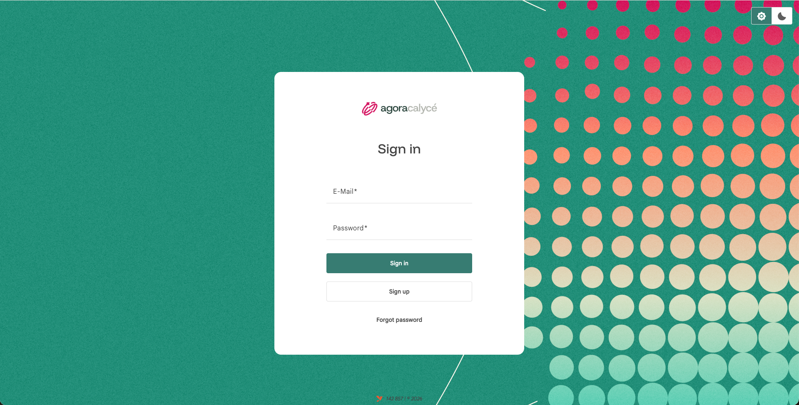

# Login

## Étape 1 : Ouvrir la Console

Ouvrez l'URL de votre Console (fournie par votre administrateur, ex. `https://console.agoracalyce.com`). Si vous n'avez pas de session active, vous êtes automatiquement redirigé vers l'écran de connexion.

## Étape 2 : Se connecter ou créer un compte

- **Vous avez déjà un compte** : saisissez votre e-mail et votre mot de passe, puis cliquez sur **Sign in with password**.
- **Première visite** : cliquez sur **Sign up** pour créer un compte. Un e-mail de vérification peut être demandé selon la configuration de votre organisation.
- **Mot de passe oublié** : cliquez sur **Forgot password** pour lancer une procédure de récupération par e-mail.

Une fois authentifié, une session de navigateur est établie et vous êtes automatiquement redirigé vers le [Dashboard](02-dashboard.md).

!!! note "Organisation et projet créés automatiquement"

    À la toute première connexion, la plateforme crée automatiquement pour vous une organisation personnelle (**Personal Org**) et un projet **default**, prêts à l'emploi, voir [Concepts](../01-introduction/02-concepts.md).

## Session expirée

Si votre session expire pendant que vous travaillez, la Console vous propose de vous reconnecter dans une fenêtre dédiée sans perdre votre page en cours ; une fois reconnecté, l'action en attente est automatiquement rejouée.