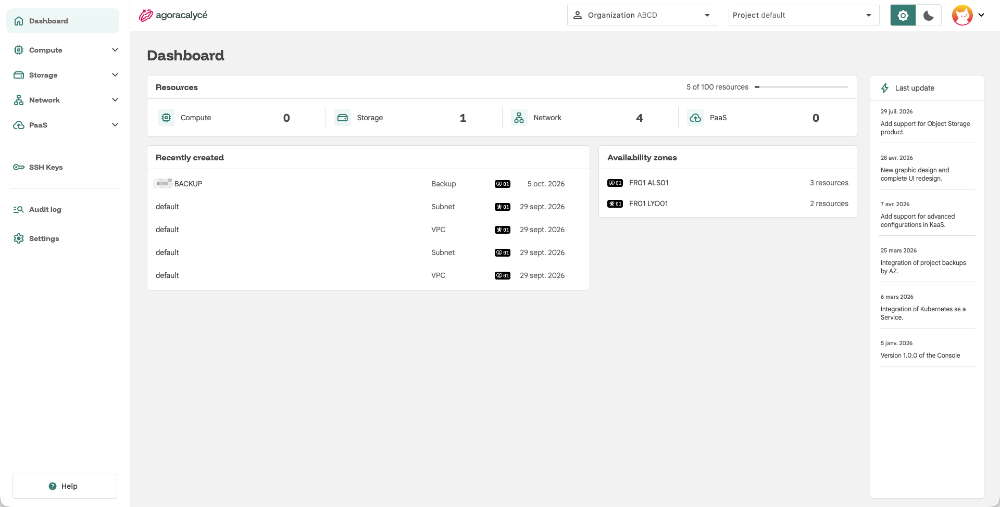

# Dashboard

La page **Dashboard** est l'écran d'accueil après connexion. Elle donne une vue d'ensemble du projet sélectionné.

## Explication rapide de chaque zone

### Barre du haut

- **Logo / retour dashboard** : ramène toujours au tableau de bord.
- **Organization** : sélecteur de l'organisation active. Voir [Création d'une organisation](../03-administration/02-creation-organisation.md).
- **Project** : sélecteur du projet actif au sein de l'organisation. Voir [Création d'un projet](../03-administration/05-creation-projet.md).
- **Icône lune/soleil** : bascule thème clair/sombre.
- **Avatar** :
    - Menu du compte utilisateur → [Son compte](../03-administration/01-son-compte.md).
    - Accès rapide pour [créer des organisations](../03-administration/02-creation-organisation.md).

### Menu de gauche (sidenav)

Reste identique sur toutes les pages authentifiées :

- **Dashboard** : cette page.
- **Compute** : instances et snapshots d'instance → [Instance](../04-utilisation/01-instance/01-creation-from-scratch.md).
- **Storage** : disques, snapshots, sauvegardes, stockage objet → [Storage](../04-utilisation/02-storage/01-creation-disque.md) et [Sauvegarde](../04-utilisation/04-sauvegarde/01-faire-sauvegarde.md).
- **Network** : VPC, subnet, EIP, load balancer, security group → [Network](../04-utilisation/03-network/01-creer-vpc.md).
- **PaaS** : Kubernetes as a Service → [Kubernetes (KaaS)](../05-paas/01-kaas/01-creer-cluster.md).
- **SSH Keys** : clés publiques SSH à injecter dans les instances.
- **Settings** : paramètres de l'organisation active.

### Corps de la page

- **Resources** : quota et compteur de ressources utilisées sur le projet actif (compute, storage, network, PaaS), avec barre de progression par rapport à la limite autorisée.
- **Recently created** : raccourci vers les dernières ressources créées, ou lien de création rapide si le projet est vide.
- **Availability zones** : répartition des ressources par zone de disponibilité.
- **Last update** : journal des nouveautés de la plateforme (changelog).