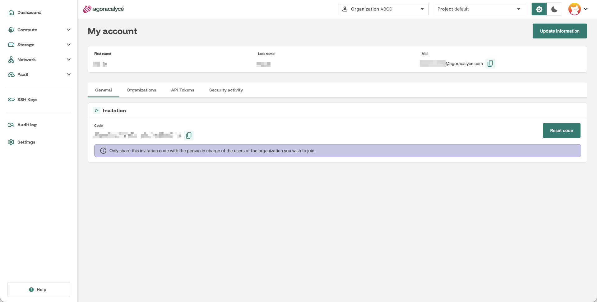
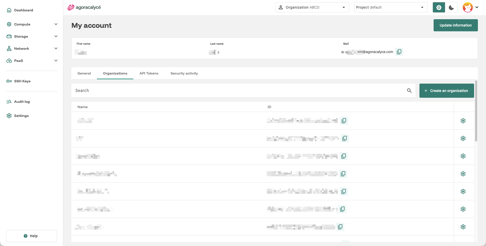
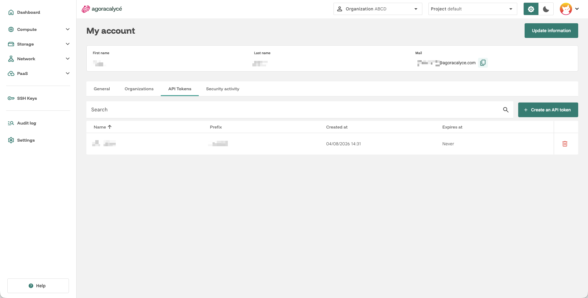
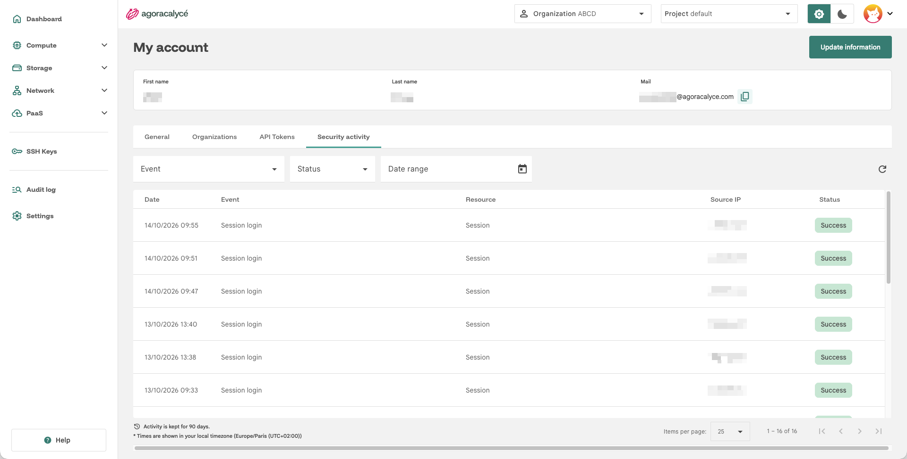

# Son compte

Cliquez sur l'avatar en haut à droite, puis **My account** pour accéder à votre profil.

L'écran se décompose en 4 onglets.

## Onglet General

- **Prénom / Nom / E-mail** : vos informations personnelles (modifiables via **Update information**, en haut à droite).
- **Code d'invitation** : code unique qui vous identifie. Un administrateur d'organisation s'en sert pour vous ajouter à son organisation, voir [Partager une organisation](03-partager-organisation.md). Bouton **Reset code** pour le régénérer si vous pensez qu'il a fuité.

!!! warning "Code d'invitation"

    Ne partagez ce code qu'avec la personne qui gère les utilisateurs de l'organisation que vous souhaitez rejoindre.

## Onglet Organizations

Liste des organisations dont vous êtes membre, avec un bouton **Create an organization**.

Voir [Création d'une organisation](02-creation-organisation.md).

## Onglet API Tokens

Génère des jetons d'API personnels pour scripter des appels à l'API de la console d'Agora Calyce sans passer par l'interface graphique.

!!! warning "Jeton affiché une seule fois"

    Le jeton n'est affiché qu'une seule fois à sa création : copiez-le immédiatement.

## Onglet Security activity

Historique de vos événements de sécurité (connexions, changements de compte…), avec les mêmes filtres et le même tableau que l'[Audit log](07-audit-log.md) d'organisation, sans les colonnes Initiator et Project. Cliquez sur une ligne pour le détail. Une note en bas du tableau indique la durée de conservation de l'activité (en jours).

