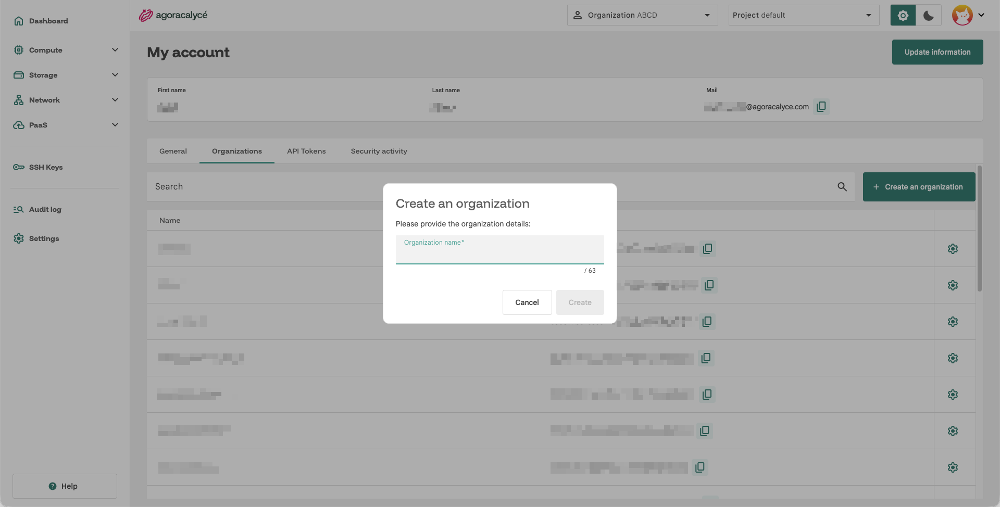

# Création d'une organisation

Une organisation personnelle (**Personal Org**) vous a déjà été attribuée automatiquement à l'inscription. Créez une organisation supplémentaire si vous voulez un espace séparé (ex. pour une équipe, un client).

## Étape par étape

1. Cliquez sur l'avatar (en haut à droite) → **My account** → onglet **Organizations**.
2. Cliquez sur **Create an organization**.

    

3. Renseignez le **nom** de l'organisation.
4. Cliquez sur **Create**.

L'organisation apparaît immédiatement dans le sélecteur **Organization** en haut de la Console et dans la liste de l'onglet Organizations. Vous en êtes automatiquement propriétaire (**Owner**).