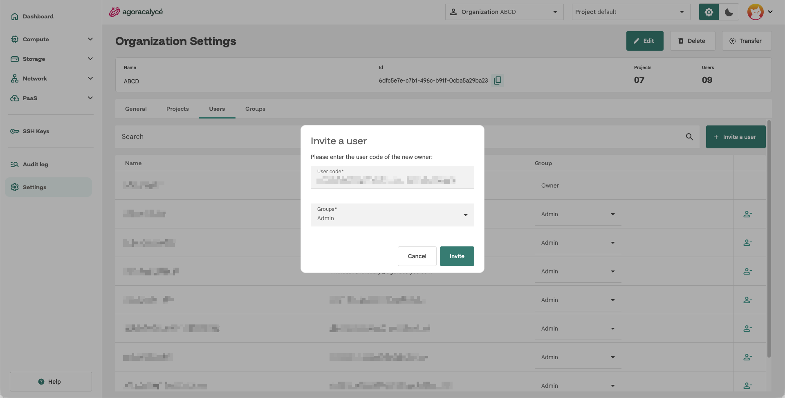

# Partager une organisation

Pour ajouter un collègue à votre organisation :

1. Demandez-lui son **code d'invitation** personnel, visible sur sa page [Son compte](01-son-compte.md) (onglet General).
2. Allez sur **Organization Settings** (menu **Settings** de la sidenav, ou l'icône engrenage orange en haut) → onglet **Users**.
3. Cliquez sur **Invite a user**.

    

4. Collez le **code utilisateur** fourni par votre collègue dans le champ **User code**.
5. Sélectionnez le ou les **groupes** (rôles) à lui attribuer, voir [Users / Groups / Droits](04-users-groups-droits.md).
6. Cliquez sur **Invite**.

Le nouvel utilisateur voit alors apparaître cette organisation dans son propre onglet **My account > Organizations** (voir [Son compte](01-son-compte.md)), et peut basculer dessus via le sélecteur **Organization** de la Console.

## Retirer un utilisateur

Depuis **Organization Settings > Users**, un administrateur peut retirer un membre via l'icône de suppression en bout de ligne (sauf le propriétaire de l'organisation, qui ne peut pas être retiré ainsi).