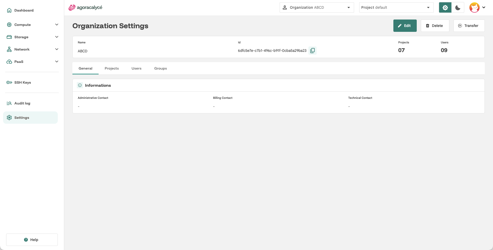
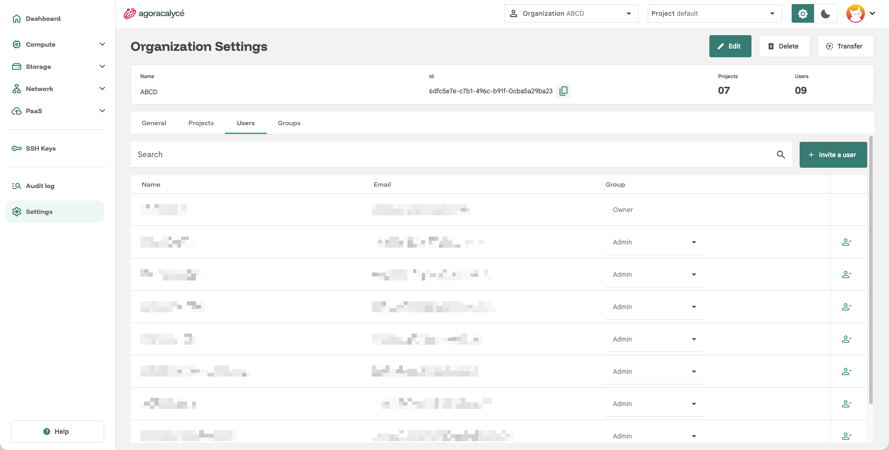
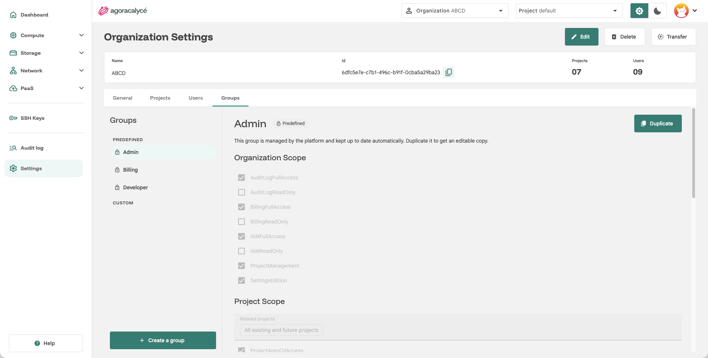
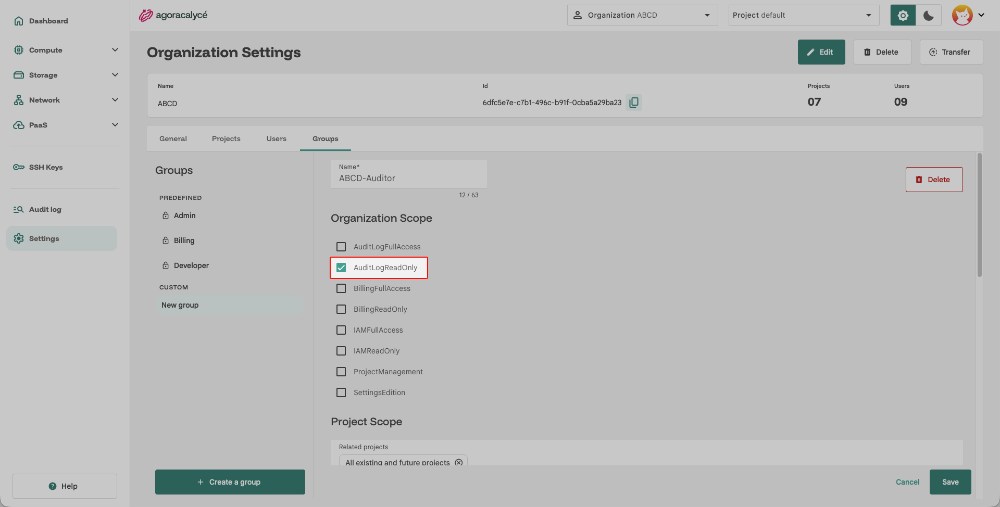

# Users / Groups / Droits

**Organization Settings** (menu **Settings** de la sidenav) propose 4 onglets : General, Projects, Users et Groups.

## Onglet Users

Liste les membres de l'organisation. Pour chaque membre (hors propriétaire) :

- Sa **colonne Group** est un sélecteur multiple : on peut lui attribuer un ou plusieurs groupes directement depuis cette liste.
- Une icône permet de le **retirer** de l'organisation.

Le bouton **Invite a user** permet d'ajouter un nouveau membre, voir [Partager une organisation](03-partager-organisation.md).

## Onglet Groups (droits)

C'est ici que se définissent les **permissions**. Un groupe est un ensemble de permissions qu'on attribue ensuite à des utilisateurs.

### Groupes prédéfinis

Trois groupes prédéfinis existent (icône cadenas, non modifiables directement) :

- **Admin** : administration complète de l'organisation.
- **Billing** : accès à la facturation.
- **Developer** : accès aux ressources techniques (compute, storage, network…).

!!! note "Adapter un groupe prédéfini"

    Pour adapter un groupe prédéfini, cliquez sur **Duplicate** : cela crée une copie personnalisée et modifiable.

### Groupes personnalisés

Cliquez sur **Create a group** pour créer un groupe sur mesure. Pour chaque groupe, vous configurez :

- **Organization Scope** : permissions au niveau de l'organisation (ex. gestion des utilisateurs, des projets).
- **Project Scope** : permissions au niveau des projets, en cochant les projets concernés (via le sélecteur de projets) puis les droits (lecture/écriture par produit : instance, disque, réseau…).

Cliquez sur **Save** pour appliquer les modifications.

### Permission Audit log
Au niveau **Organization Scope**, deux permissions gèrent l'[Audit log](07-audit-log.md), regroupées en deux ensembles de permissions à rattacher aux groupes :

| Ensemble | Droits accordés |
|---|---|
| **AuditLogReadOnly** | Lire l'audit log et la rétention (l'entrée **Audit log** n'apparaît dans la sidenav qu'avec ce droit). |
| **AuditLogFullAccess** | Lecture, et modification de la rétention. |

Le groupe prédéfini **Admin** dispose de **AuditLogFullAccess**. Il n'existe pas de permission d'audit au niveau d'un projet.

!!! note "Profil auditeur"

    Pour un profil « auditeur » qui doit consulter le journal sans toucher à la rétention, créez un groupe personnalisé avec **AuditLogReadOnly**.

### Attribuer un groupe à un utilisateur

Deux façons équivalentes :

- Depuis l'onglet **Users** (colonne Group), voir ci-dessus.
- Au moment de l'invitation, via **Invite a user**, voir [Partager une organisation](03-partager-organisation.md).

!!! note "Au moins un groupe"

    Un utilisateur doit toujours appartenir à au moins un groupe.