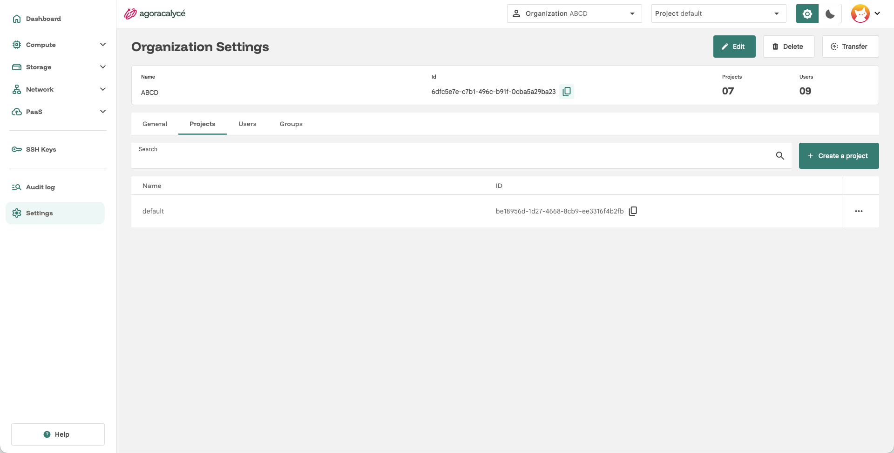
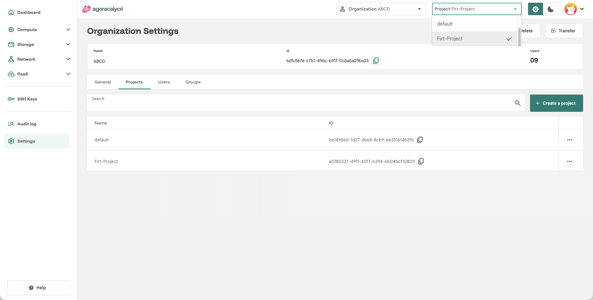

# Création d'un projet

Toutes les ressources (instances, disques, réseaux…) sont créées à l'intérieur d'un **projet**, lui-même rattaché à une organisation. Un projet nommé `default` existe déjà dans votre organisation personnelle.

## Étape par étape

1. Allez sur **Organization Settings** (menu **Settings** de la sidenav) → onglet **Projects**.

    

2. Cliquez sur **Create a project**.
3. Renseignez le **nom** du projet.
4. Validez.

Le projet apparaît alors dans le sélecteur **Project** en haut de la Console (voir [Dashboard](../02-prise-en-main/02-dashboard.md)) et dans la liste de l'onglet Projects, où vous pouvez ensuite le **modifier** (Edit) ou le **supprimer** (Delete) via le menu d'actions en bout de ligne.

## Basculer entre projets

Le sélecteur **Project** en haut de chaque page détermine sur quel projet portent les actions et les listes affichées. Changez de projet à tout moment pour travailler dans un autre espace, utile par exemple pour séparer un environnement de test d'un environnement de production au sein de la même organisation.

---

Vous avez maintenant un compte, une organisation et un projet prêts à l'emploi. Passez à la partie [Utilisation](../04-utilisation/01-instance/01-creation-from-scratch.md) pour créer vos premières ressources.