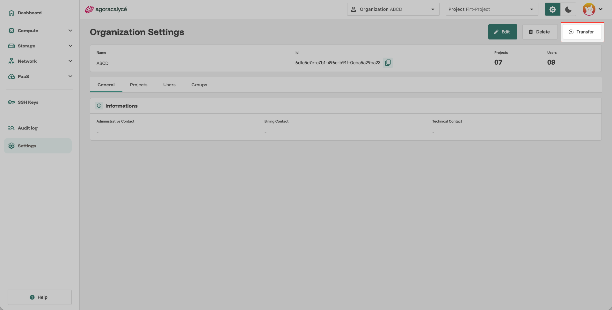
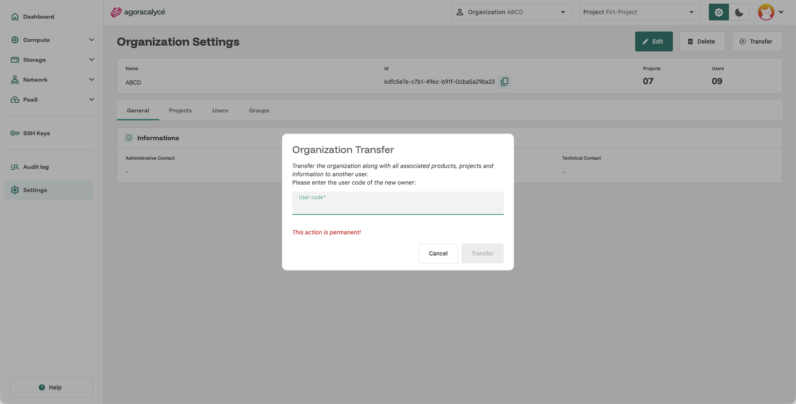

# Transférer une organisation

Transférer une organisation change son **propriétaire** (Owner, le *superadmin* de l'organisation) : un autre membre devient responsable de l'organisation, vous en perdez la propriété (mais pouvez en rester membre selon les groupes qui vous sont attribués).

## Prérequis

- Vous devez être le **propriétaire actuel** de l'organisation.
- Vous ne pouvez pas transférer votre **dernière organisation** : il vous faut appartenir à au moins une autre organisation en plus de celle-ci.
- Le nouveau propriétaire doit déjà être **membre** de l'organisation, ou vous fournir son **code d'invitation** personnel (visible sur sa page [Son compte](01-son-compte.md), onglet General), voir [Partager une organisation](03-partager-organisation.md) si ce n'est pas encore le cas.

## Étape par étape

1. Allez sur **Organization Settings** (menu **Settings** de la sidenav, ou l'icône engrenage orange en haut) → onglet **General**.

    

2. Repérez la section **Transfer ownership**.
3. Renseignez le **code utilisateur** (invite code) du membre à qui transférer l'organisation.

    

4. Confirmez le transfert.

## Après le transfert

- Le nouveau propriétaire récupère le groupe **Owner**, avec tous les droits d'administration sur l'organisation, voir [Users / Groups / Droits](04-users-groups-droits.md).
- L'organisation disparaît de votre statut de propriétaire, mais reste visible dans votre onglet **My account > Organizations** si vous en êtes toujours membre (voir [Son compte](01-son-compte.md)).