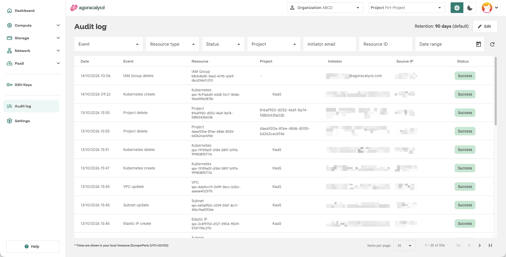
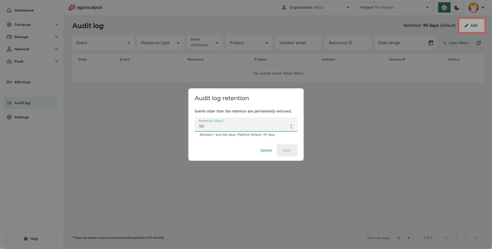
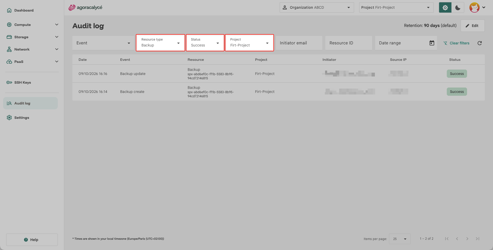
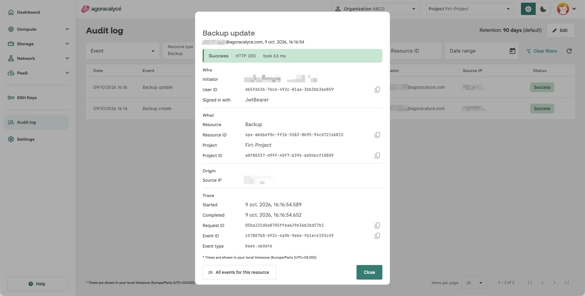

# Audit log

L'**Audit log** trace les actions effectuées dans une organisation (qui a fait quoi, quand, sur quelle ressource, avec quel résultat). Il est accessible via l'entrée **Audit log** de la sidenav (menu organisation), si votre groupe possède la permission de lecture correspondante, voir [Users / Groups / Droits](04-users-groups-droits.md#permission-audit-log).

## Rétention

En haut de page, **Retention** indique la durée de conservation des événements (en jours). La mention **(default)** apparaît si la valeur par défaut de la plateforme est utilisée.

!!! warning "Suppression définitive"

    Les événements plus anciens que la rétention sont **supprimés définitivement**, lors d'un nettoyage automatique qui s'exécute toutes les heures. Sur une installation standard, la rétention par défaut est de 90 jours et peut être réglée entre 1 et 365 jours (bornes fixées par l'exploitant de la plateforme).

Avec la permission d'écriture sur l'audit log, le bouton **Edit** ouvre la fenêtre **Audit log retention** :

- **Retention (days)** : nombre entier de jours, entre les bornes minimale et maximale affichées sous le champ (rappel de la valeur par défaut de la plateforme).
- Une bannière d'avertissement s'affiche si vous **réduisez** la rétention, puis une seconde fenêtre (**Lower the audit log retention?**) demande confirmation : l'historique plus ancien disparaît au prochain nettoyage, sans retour possible. Le changement de rétention est lui-même tracé dans le journal (**Audit log retention update**).
- **Reset to default** (visible si une valeur personnalisée est définie) restaure la valeur par défaut.

## Filtres

- **Event** : un ou plusieurs types d'événement (regroupés par type de ressource, limités à un nombre maximal de sélections). **Retired event types** regroupe les types d'événements qui n'existent plus.
- **Resource type** : type de ressource concerné.
- **Status** : `Success`, `Failed` ou `Attempted`.
- **Project** : projet concerné.
- **Initiator email** : e-mail de l'utilisateur à l'origine de l'action (validez avec Entrée).
- **Resource ID** : identifiant de la ressource (validez avec Entrée).
- **Date range** : plage de dates (**From** / **To**).

**Clear filters** réinitialise tous les filtres ; l'icône d'actualisation recharge la liste.

## Tableau des événements

| Colonne | Contenu |
|---|---|
| **Date** | Horodatage de l'événement |
| **Event** | Type d'événement (survol : identifiant technique) |
| **Resource** | Ressource concernée |
| **Project** | Projet de la ressource |
| **Initiator** | Utilisateur à l'origine de l'action |
| **Source IP** | Adresse IP d'origine de la requête |
| **Status** | `All`, `Success`, `Failed` ou `Attempted` |

Le tableau est paginé. Cliquez sur une ligne pour ouvrir le **détail de l'événement**.

## Security activity (utilisateur)

Chaque utilisateur peut aussi consulter **sa propre** activité de sécurité depuis **My account**, voir [Son compte](01-son-compte.md#onglet-security-activity).

!!! warning "Connexion inconnue"

    Une connexion depuis une adresse que vous ne reconnaissez pas est le signal pour changer votre mot de passe et révoquer vos jetons dans l'onglet **API Tokens**.