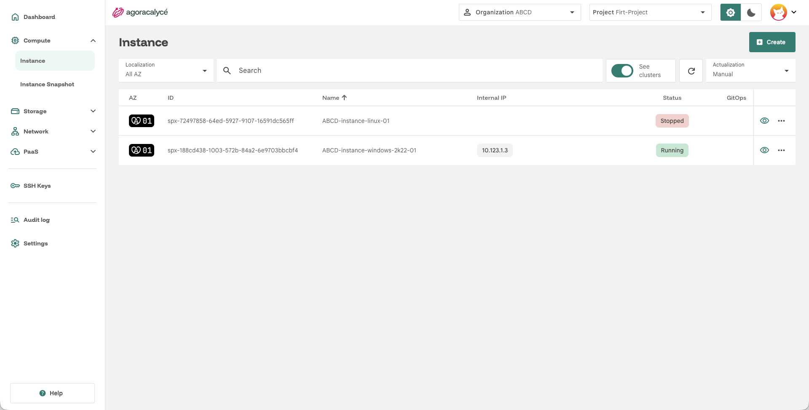
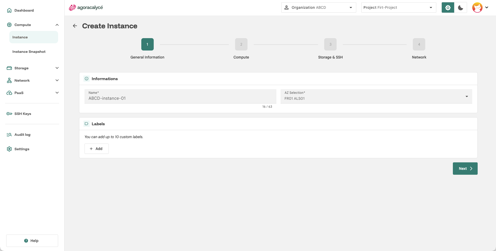
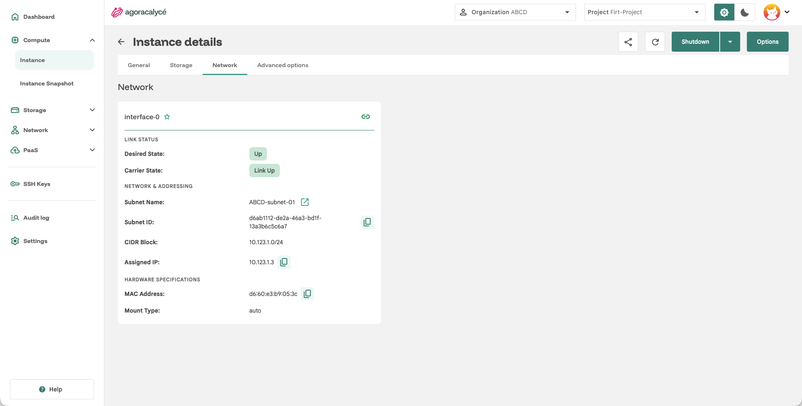

# Instance from scratch

## Prérequis

Une instance a besoin d'un **subnet** existant pour son réseau. Si vous n'en avez pas encore :

1. [Créer un VPC](../03-network/01-creer-vpc.md)
2. [Créer un subnet](../03-network/02-creer-subnet.md)
3. Disposer d'une image Cloud ou de l'ISO préalablement injectée dans un disque → [Créer un disque](../02-storage/01-creation-disque.md)

!!! note "VPC et subnet par défaut"

    Chaque AZ dispose d'un VPC `default` et d'un subnet `default` (`10.10.0.0/16`, sans NAT gateway). Vous pouvez les utiliser directement pour une première instance. Créez les vôtres si vous avez besoin d'une plage d'adresses particulière, d'un réseau isolé ou d'une NAT gateway.

!!! note "Importer une clé SSH au préalable"

    Optionnel mais recommandé : une [clé SSH](../../02-prise-en-main/02-dashboard.md) importée au préalable (menu **SSH Keys** de la sidenav) pour pouvoir se connecter à la VM une fois créée.

## Étape 1 : Ouvrir la liste des instances

Menu **Compute > Instance**.

Cliquez sur **Create an instance**. L'assistant se déroule en 4 étapes.

## Étape 2 : General Information

- **Name** : nom de l'instance (63 caractères max).
- **AZ Selection** : zone de disponibilité où provisionner l'instance.
- **Labels** (optionnel) : jusqu'à 10 labels personnalisés, utiles ensuite pour cibler l'instance dans un [Security Group](../03-network/05-security-group.md) ou un [Load Balancer](../03-network/04-load-balancer.md) par sélection de label.

Cliquez sur **Next**.

## Étape 3 : Compute

- **RunStrategy** : politique de démarrage et de redémarrage de la VM.
    - `Manual` : la VM est créée arrêtée et ne démarre que sur action explicite (**Start**). Adapté au développement, au staging et à la maintenance.
    - `Always` : la VM démarre dès que ses disques sont prêts et redémarre automatiquement si elle s'arrête ou plante. Adapté aux services de production et aux bases de données.
    - `RerunOnFailure` : la VM redémarre uniquement si elle s'arrête en erreur. Adapté aux traitements par lots.
    - `Once` : la VM démarre une seule fois et ne redémarre pas, même en cas d'échec. Adapté aux tâches ponctuelles.
    - `Halted` : la VM reste éteinte tant que la stratégie n'est pas modifiée. Adapté aux instances désactivées ou archivées.
- **Instance Type** : gabarit prédéfini (dépend de l'AZ sélectionnée) ; le choix Linux ou Windows détermine plusieurs options des étapes suivantes, voir [Guide Linux](02-guide-linux.md) / [Guide Windows](03-guide-windows.md).
- **Cores** : nombre de vCPU (1, 2, 4, 8, 16 ou 32).
- **RAM** : quantité de mémoire en Go (1, 2, 4, 8, 16, 32 ou 64).
- Un bloc **configuration avancée** permet d'ajuster des options spécifiques au type d'instance et au système d'exploitation choisi.

Cliquez sur **Next**.

## Étape 4 : Storage & SSH

- **CloudInit Configuration** : mode de montage du volume cloud-init, avec possibilité de personnaliser sa configuration (bascule **Customize configuration**, puis **Edit configuration**). Détails par OS : [Guide Linux](02-guide-linux.md).
    - **Configuration par défaut** (si vous ne la personnalisez pas) : création d'un utilisateur `spx` avec `sudo` sans mot de passe, mot de passe initial généré qui expire à la première connexion, authentification SSH par mot de passe activée en plus des clés sélectionnées, résolveurs DNS `1.1.1.1` et `1.0.0.1`. Le mot de passe généré est consultable dans l'onglet **Storage** de la page de détail de l'instance (ligne **UserData**, bouton **Show**).
- **Disk Configuration** : attachez un ou plusieurs disques existants (recherche + auto-complétion), ou cliquez sur **Create a disk** pour en créer un nouveau à la volée, voir [Création de disque](../02-storage/01-creation-disque.md). Chaque disque attaché a un **mount type** configurable et peut être glissé-déposé pour changer son ordre de démarrage. Chaque disque peut être défini comme CD-Rom.
    - **Mount type** du disque : bus utilisé pour présenter le disque à la VM. `virtio` (recommandé, meilleures performances), `sata` (systèmes anciens ou supports dépourvus de pilotes VirtIO) ou `auto` (choix automatique selon le système invité).
- **Driver Disks** (uniquement si l'instance type est *windows*) : disques pilotes additionnels (ex. pilotes VirtIO pour Windows), pré-cochés selon les recommandations de la plateforme, voir [Guide Windows](03-guide-windows.md).
- **SSH Keys** : sélectionnez une ou plusieurs clés SSH à injecter au premier démarrage (Linux uniquement, voir [Guide Linux](02-guide-linux.md)).

Cliquez sur **Next**.

## Étape 5 : Network

- Sélectionnez un **subnet** dans la liste déroulante **Add a subnet**. Si aucun subnet n'apparaît, créez-en un d'abord via le lien fourni directement dans le formulaire, ou voir [Créer un subnet](../03-network/02-creer-subnet.md).
- Pour chaque interface réseau ajoutée : IP fixe optionnelle (IPv4/IPv6, automatique si laissé vide), **adresse MAC** optionnelle et **mount type** de l'interface.
- **Mount type** de l'interface : modèle de carte réseau. `virtio` (par défaut, meilleures performances ; natif sous Linux, pilotes VirtIO nécessaires sous Windows) ou `e1000` (carte Intel émulée, pour les systèmes anciens sans pilotes VirtIO).
- **MAC Address** : automatique si laissée vide (format `52:54:00:xx:xx:xx`, séparateur `:` uniquement, un séparateur `-` est refusé). L'icône dédiée génère une adresse aléatoire.
- Plusieurs interfaces peuvent être ajoutées et réordonnées par glisser-déposer.

Le bouton **Create** devient actif une fois qu'au moins un subnet est configuré. Cliquez dessus pour lancer la création. Vous êtes redirigé vers la page de détail de l'instance, où elle apparaît avec le statut de provisionnement en cours.

## Après la création

Depuis la page de détail d'une instance, vous pouvez notamment :

- ouvrir une **console VNC** ou un **terminal** web intégrés (la console VNC propose un clavier virtuel, avec collage, et respecte les claviers AZERTY),
- **modifier** l'instance (redimensionnement, réseau…) via **Update**,
- [créer un snapshot](04-creation-snapshot.md) de l'instance,
- consulter l'onglet **Network** (voir ci-dessous),
- si l'instance est un nœud d'un cluster Kubernetes, ouvrir le cluster parent via **See cluster** (menu d'actions ; droit de lecture KaaS requis).

### Onglet Network

Une carte par interface réseau (l'étoile désigne l'interface **primaire**) :

- **Link Status** : **Desired State** (`Up`/`Down`, état demandé) et **Carrier State** (état réel sur la VM en fonctionnement). Le bouton lien/lien barré active ou désactive l'interface ; **Updating link state…** s'affiche pendant la synchronisation. Un badge **Primary interface disabled** prévient si l'interface primaire est désactivée.
- **Network & Addressing** : subnet (nom, ID, CIDR, lien vers sa page), ou nom du réseau Multus, et **Assigned IP**.
- **Hardware Specifications** : **MAC Address** et **Mount Type** (`auto` par défaut) ou le modèle de carte (`virtio`, `e1000`).

### Démarrer l'instance et suivre le provisionnement

À la création, le statut est `Pending` le temps que le disque importe son image : suivez l'avancement dans l'onglet **Storage** (colonne **Progress**). Avec la RunStrategy `Always`, la VM démarre seule quand le disque est prêt et passe à `Running`. Avec `Manual`, cliquez sur **Start** en haut de la page.

### Actions d'alimentation

Depuis la page de détail :

- **Start** : démarre une instance arrêtée.
- **Shutdown** : demande un arrêt propre au système invité (signal ACPI).
- **Force Shutdown** : coupe immédiatement l'alimentation, à réserver au cas où le système ne répond plus.
- **Restart** : demande un redémarrage au système.

### Consoles

Le menu **Options** de la page de détail donne accès à deux consoles dans le navigateur, utiles avant que le réseau soit configuré ou pendant le démarrage :

- **Serial** : terminal texte interactif.
- **Console** : console graphique VNC, avec clavier virtuel (combinaisons comme `Ctrl+Alt+Suppr`).