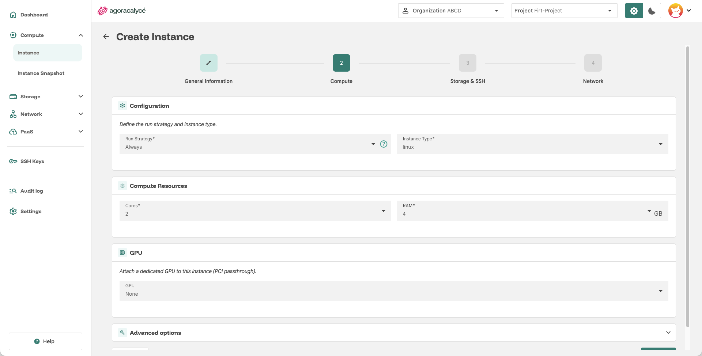
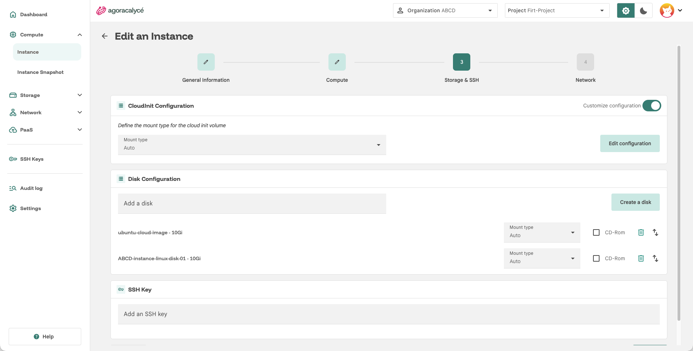
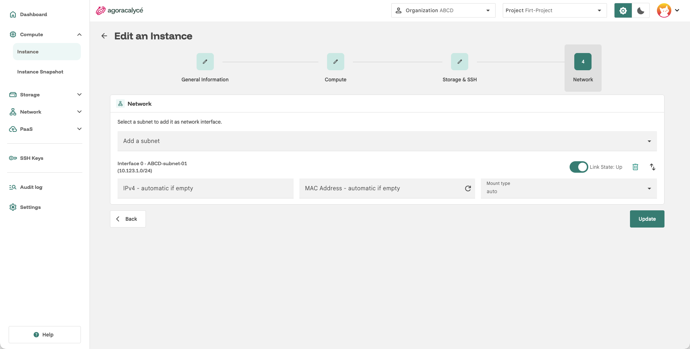
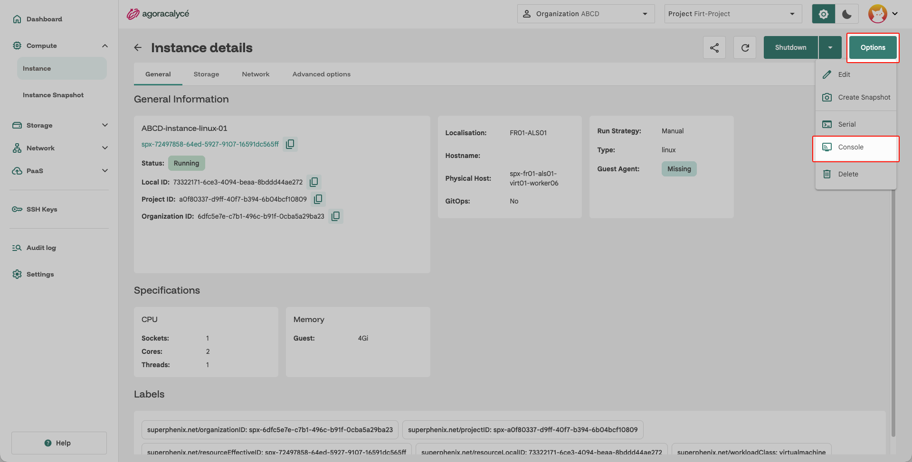

# Linux

Ce guide complète [Création from scratch](01-creation-from-scratch.md) : suivez l'assistant en 4 étapes, en appliquant les choix ci-dessous aux étapes concernées.

## Étape 2 : General Information

- **Name** : nom de l'instance.
- **AZ Selection** : zone de disponibilité où provisionner l'instance.
- **Labels** (optionnel) : labels personnalisés, utiles ensuite pour cibler l'instance dans un [Security Group](../03-network/05-security-group.md) ou un [Load Balancer](../03-network/04-load-balancer.md).

## Étape 3 : Compute

- **Instance Type** : choisissez un gabarit basé sur une distribution Linux (ex. Ubuntu, Debian, Rocky…).

## Étape 4 : Storage & SSH

- **CloudInit Configuration** : laissez le mode par défaut (utilisateur `spx` avec `sudo` sans mot de passe, mot de passe initial généré, DNS `1.1.1.1` et `1.0.0.1`), ou activez **Customize configuration** pour injecter votre propre `#cloud-config` (création d'utilisateurs, paquets, fichiers, commandes au premier démarrage…).
- **Disk Configuration** : ajouter le disque avec l'image Cloud et/ou créer un disque à la volée via **Create a disk**.
    - Exemple : créez un disque de type **Http** avec l'URL de l'image cloud Ubuntu 24.04 (`https://cloud-images.ubuntu.com/noble/current/noble-server-cloudimg-amd64.img`) et une taille supérieure à celle de l'image (par exemple 20 Gio).
    - Un disque de type **Blank** n'a pas de système d'exploitation : la VM s'arrêterait au démarrage sur l'invite du firmware.

- **SSH Keys** : sélectionnez au moins une clé SSH importée au préalable. Cloud-init l'injecte dans le compte par défaut de l'image au premier démarrage.

## Étape 5 : Network

- **Network** : sélectionnez un subnet créé préalablement

## Après la création

- Connexion : `ssh spx@<ip-instance>` (utilisateur par défaut de la configuration cloud-init) avec la clé sélectionnée, ou via la **console web intégrée** depuis la page de détail de l'instance.

    

- Sans clé SSH, ou pour une première connexion par mot de passe : le mot de passe initial de `spx` est consultable dans l'onglet **Storage** de la page de détail de l'instance (ligne **UserData**, bouton **Show**, bloc `chpasswd`). Il expire à la première connexion et le système demande d'en choisir un nouveau. Privilégiez néanmoins la connexion par clé SSH.

### Agent invité (qemu-guest-agent)

!!! note "Installer l'agent invité"

    Installer `qemu-guest-agent` dans le système invité (sous Debian/Ubuntu : `apt install qemu-guest-agent`) permet à la Console d'afficher les adresses IP réelles de l'instance et des métriques d'utilisation, et rend les [snapshots d'instance](04-creation-snapshot.md) cohérents au niveau du système de fichiers.