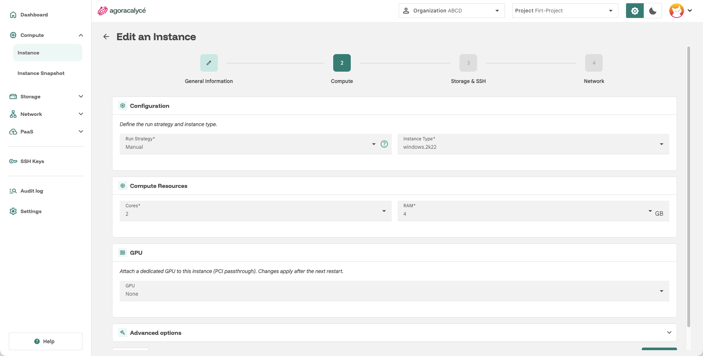
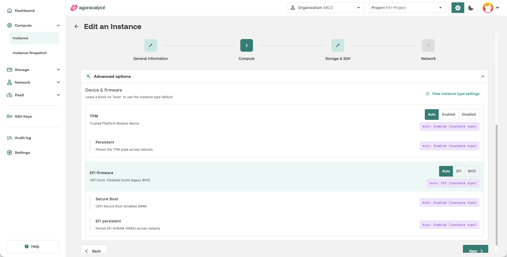
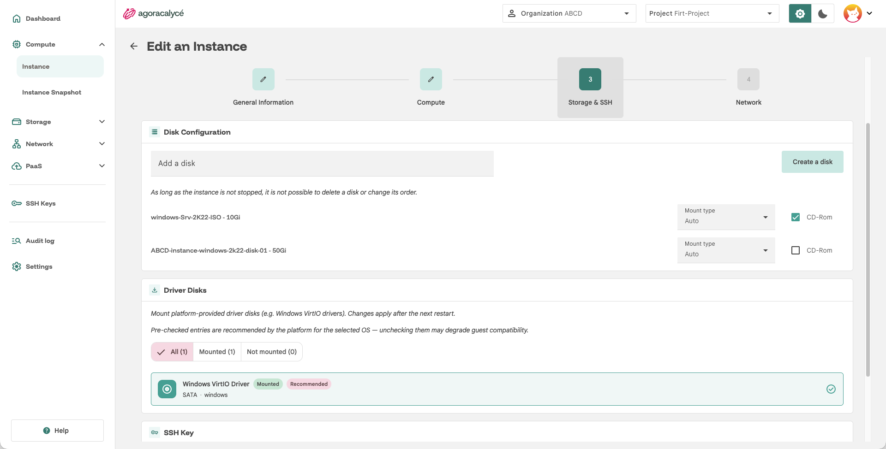
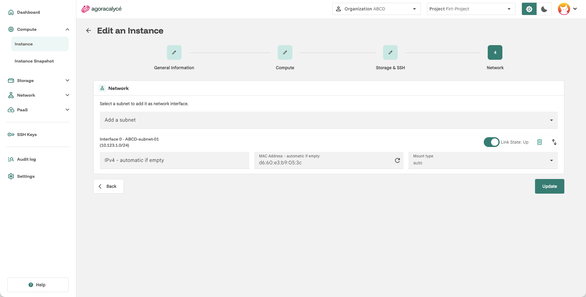
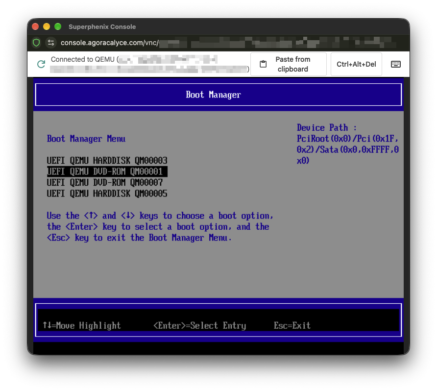
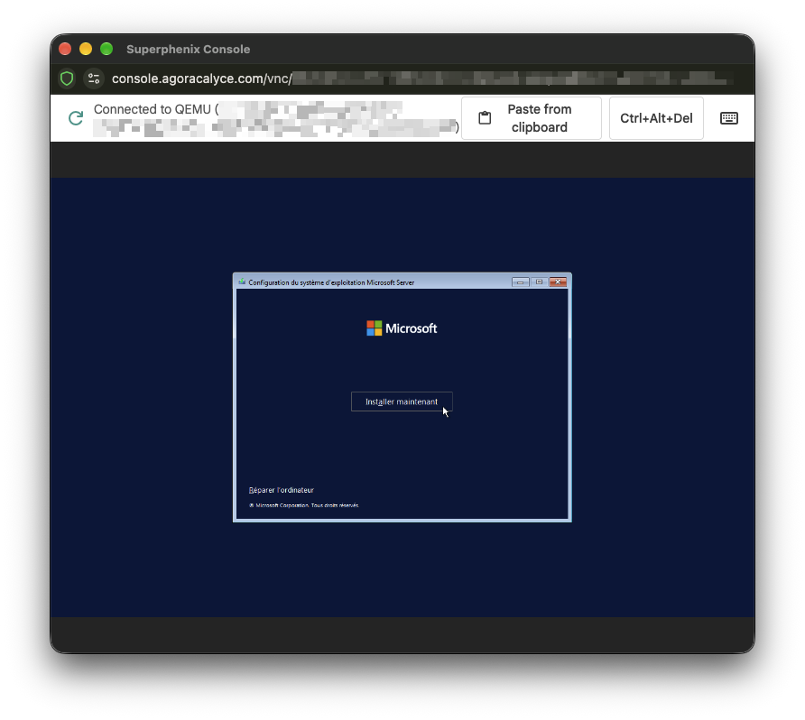

# Windows

Ce guide complète [Création from scratch](01-creation-from-scratch.md) : suivez l'assistant en 4 étapes, en appliquant les choix ci-dessous aux étapes concernées.

## Étape 2 : General Information

- **Name** : nom de l'instance.
- **AZ Selection** : zone de disponibilité où provisionner l'instance.
- **Labels** (optionnel) : labels personnalisés, utiles ensuite pour cibler l'instance dans un [Security Group](../03-network/05-security-group.md) (ex. pour ouvrir le port RDP).

## Étape 3 : Compute

- **Instance Type** : choisissez un gabarit basé sur une image Windows (ex. Windows Server 2022).

### Advanced Options

Selon la **version de Windows** choisie dans **Instance Type**, les options du bloc **Advanced Options** sont **automatiquement activées (Enabled) ou désactivées (Disabled)** : par exemple le **TPM**, le démarrage en **EFI** (plutôt que BIOS) et le **Secure Boot**. Windows 11 impose notamment TPM, EFI et Secure Boot, ce qui n'est pas le cas des versions plus anciennes.

- Chaque bloc propose trois positions : **Auto** (valeur héritée du type d'instance, et des valeurs par défaut de la plateforme), **On** ou **Off** (valeur forcée manuellement).

!!! note "Laisser Auto sauf besoin particulier"

    Laissez **Auto** sauf besoin particulier : c'est la configuration recommandée pour le système sélectionné.

    Ces réglages ne s'appliquent qu'au **prochain démarrage** de l'instance : si vous les modifiez sur une instance en fonctionnement, un redémarrage est nécessaire pour les prendre en compte.

## Étape 4 : Storage & SSH

- **CloudInit Configuration** : **cloud-init** est le seul mécanisme de configuration au premier démarrage pris en charge aujourd'hui par la plateforme. **Sysprep n'est pas pris en charge** pour le moment.
- **Disk Configuration** : un disque contenant l'**ISO de Windows** est **obligatoire** pour installer le système. Attachez-le à l'instance (créez-le au préalable, ou à la volée via **Create a disk**, voir [Création de disque](../02-storage/01-creation-disque.md)) et cochez **CD-Rom** pour ce disque afin qu'il soit présenté comme lecteur optique. Ajoutez aussi un disque vierge pour le système.
    
- **Driver Disks** : cochez (ou vérifiez qu'il est déjà coché) le disque pilote **Windows VirtIO Driver**.
- **SSH Keys** : sans objet pour Windows. Ignorez cette section, l'injection de clés SSH n'a pas d'effet sur ce type d'instance.

!!! note "Pilote VirtIO indispensable"

    Le disque pilote **Windows VirtIO Driver** est indispensable, sans quoi Windows ne détecte ni le disque système ni la carte réseau virtio.

## Étape 5 : Network

- **Network** : sélectionnez un subnet créé préalablement.

## Après la création

### Boot et installation de Windows

Une fois l'instance créée, Windows n'est pas encore installé : il faut démarrer depuis l'ISO.

1. Démarrez l'instance via **Start** dans son menu d'actions.
2. Ouvrez la **console VNC** intégrée depuis la page de détail de l'instance.
3. L'instance ne démarre **pas toujours directement sur le CD-ROM**. Si l'installateur Windows n'apparaît pas, accédez au **boot manager menu** (touche à presser au tout début du démarrage, dans la console VNC) puis sélectionner **boot manager**. Sélectionnez le **CD-ROM** comme périphérique de démarrage. Si le disque ne démarre pas, vous avez sélectionné le disque drivers VirtIO.
    
4. Suivez l'installateur Windows. Si le disque système n'est pas détecté, chargez le pilote depuis le disque **Windows VirtIO Driver** (voir [Driver Disks](#etape-4-storage-ssh)).

### Connexion

- Première connexion : depuis la **console VNC**, connectez-vous avec les identifiants de votre image Windows (ou ceux définis via votre configuration cloud-init).
- Pour un accès RDP, ouvrez le port **3389** sur le [Security Group](../03-network/05-security-group.md) ciblant l'instance (par label), puis associez si besoin une [EIP](../03-network/03-creer-eip.md) au subnet pour y accéder depuis l'extérieur.