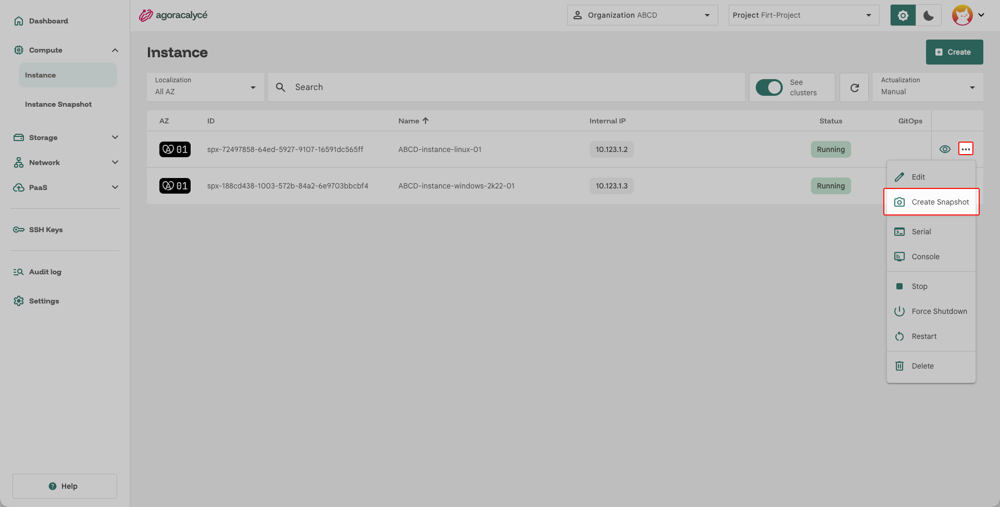
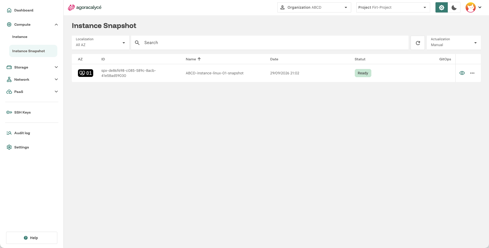

# Snapshot d'instance

Un snapshot d'instance capture l'état complet d'une VM (disques compris) à un instant T, utilisable pour restaurer ou dupliquer cette VM plus tard.

## Étape par étape

1. Ouvrez la page de détail de l'instance à sauvegarder (menu **Compute > Instance**, puis cliquez sur l'instance concernée).
2. Ouvrez le menu d'actions de l'instance et cliquez sur **Create Snapshot**.

    

3. Dans la boîte de dialogue :
    - Renseignez le **nom du snapshot** (63 caractères max).
4. Cliquez sur **Create**.

!!! note "Instance en pause pendant le snapshot"

    La création d'un snapshot prend du temps et n'est pas disponible immédiatement. Pendant l'opération, l'instance est mise en pause : évitez de l'utiliser pendant ce processus.

## Consulter les snapshots

Menu **Compute > Instance Snapshot** liste tous les snapshots d'instance du projet.

Depuis cette liste, ouvrez un snapshot pour voir son détail, le restaurer sur une nouvelle instance, ou le supprimer.

## Cohérence du snapshot

Le snapshot repose sur des copies de blocs instantanées (*copy-on-write*) et sur l'agent invité :

1. Si `qemu-guest-agent` est installé dans la VM, la plateforme fige brièvement le système de fichiers (`fsfreeze`) pour vider les tampons en mémoire vers le disque.
2. Les disques attachés sont capturés ensemble.
3. Le système de fichiers est immédiatement dégelé et l'activité reprend.
4. La configuration de la VM (CPU, RAM, bus, interfaces réseau) est enregistrée avec le snapshot.

!!! note "Sans agent invité"

    Sans `qemu-guest-agent` (ou s'il ne répond pas), le snapshot est réalisé sans gel : il est alors cohérent après plantage (*crash-consistent*) mais pas au niveau du système de fichiers. Installez l'agent pour obtenir des snapshots fiables.

## Snapshots de disque associés

Chaque snapshot d'instance génère automatiquement un snapshot pour chaque disque attaché. Ces snapshots de disque sont visibles dans le détail du snapshot (disque source, capacité, date de création, état) et peuvent aussi servir à créer un nouveau disque, voir [Snapshot de disque](../02-storage/03-snapshot-disque.md).

## Restaurer un snapshot

La restauration remet la configuration matérielle de la VM et **tous ses disques** dans l'état capturé :

1. Ouvrez la page de détail de l'instance, onglet **Snapshots**.
2. Sélectionnez le point de restauration et confirmez.

!!! warning "Restauration irréversible"

    La restauration écrase le contenu de tous les disques attachés avec les données du snapshot. Tout ce qui a été écrit depuis est définitivement perdu. Une fois la restauration terminée, l'instance redémarre selon sa RunStrategy.