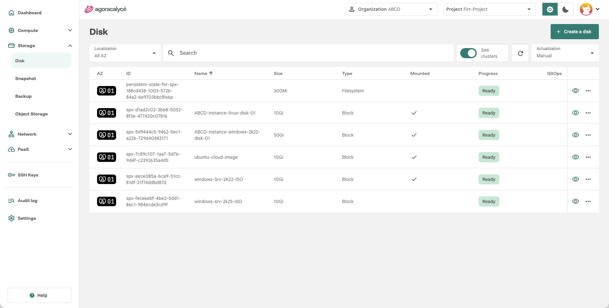
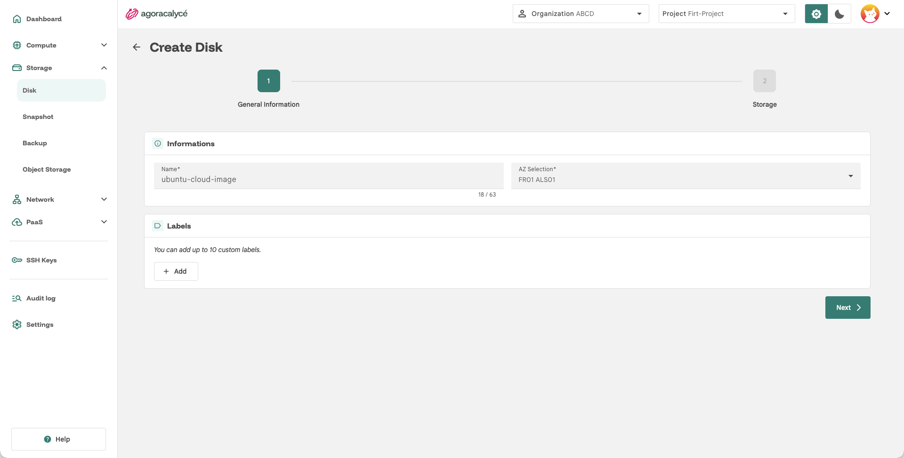
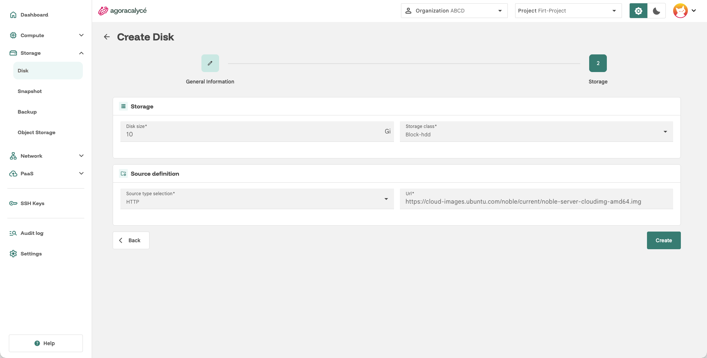

# Création de disque

## Étape 1 : Ouvrir la liste des disques

Menu **Storage > Disk**.

Cliquez sur **Create a disk**.

## Étape 2 : General Information

- **Name** : nom du disque.
- **AZ Selection** : zone de disponibilité.
- **Labels** (optionnel) : jusqu'à 10 labels personnalisés.

Cliquez sur **Next**.

## Étape 3 : Storage

- **Disk size** : taille en Gio (5000 Gio max).
- **Storage class** : classe de stockage disponible dans l'AZ sélectionnée, voir [Classes de stockage](02-classes-de-stockage.md).

### Type de source (Source type selection)

Cinq types de source sont disponibles :

| Type | Description | Champ(s) associé(s) |
|---|---|---|
| **Blank** | Disque vide, sans données. | Aucun. |
| **Http** | Disque initialisé depuis une image téléchargée par URL HTTP(S). | **Url** : lien vers l'image source. |
| **Snapshot** | Disque créé à partir d'un [snapshot de disque](03-snapshot-disque.md) existant. | **Select a snapshot** : liste des snapshots disponibles dans l'AZ. |
| **Clone** | Copie d'un disque existant. | **Select a disk** : liste des disques disponibles (les disques déjà montés sont indiqués "In use"). |
| **Registry** *(par défaut)* | Disque initialisé depuis une image de conteneur (container disk image). | **Url** : référence de l'image registry. |

!!! note "Taille minimale pour Clone et Snapshot"

    Pour **Clone** et **Snapshot**, la taille du disque (**Disk size**) doit être égale ou supérieure à la taille de la source : la Console ajuste automatiquement la valeur minimale acceptée.

!!! note "Arrêter l'instance avant de cloner"

    Le clonage d'un disque en cours d'utilisation par une instance active peut provoquer des erreurs : arrêtez l'instance avant de cloner son disque.

Cliquez sur **Create**.

## Après la création

Le disque créé peut ensuite être attaché à une instance (voir [Création d'une instance from scratch](../01-instance/01-creation-from-scratch.md#etape-4-storage-ssh)) ou géré depuis sa page de détail (redimensionnement, suppression, snapshot). Si le disque appartient à un cluster Kubernetes, l'action **See cluster** du menu ouvre le cluster parent (droit de lecture KaaS requis).

<!-- Capture à insérer : ../images/disk-details-see-cluster.png, menu d'actions d'un disque de cluster. -->