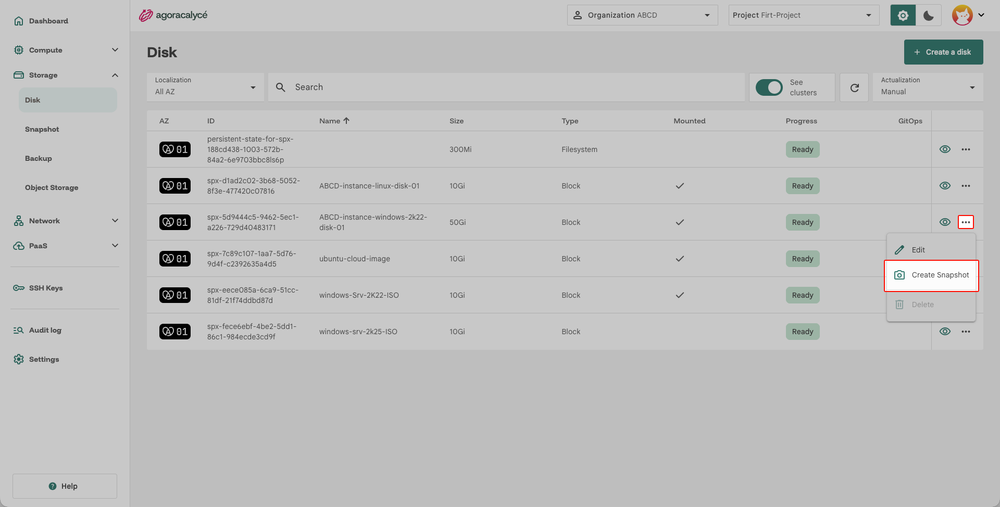
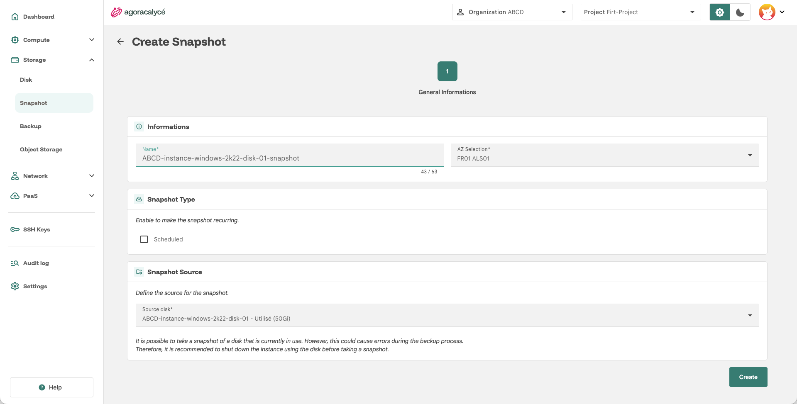
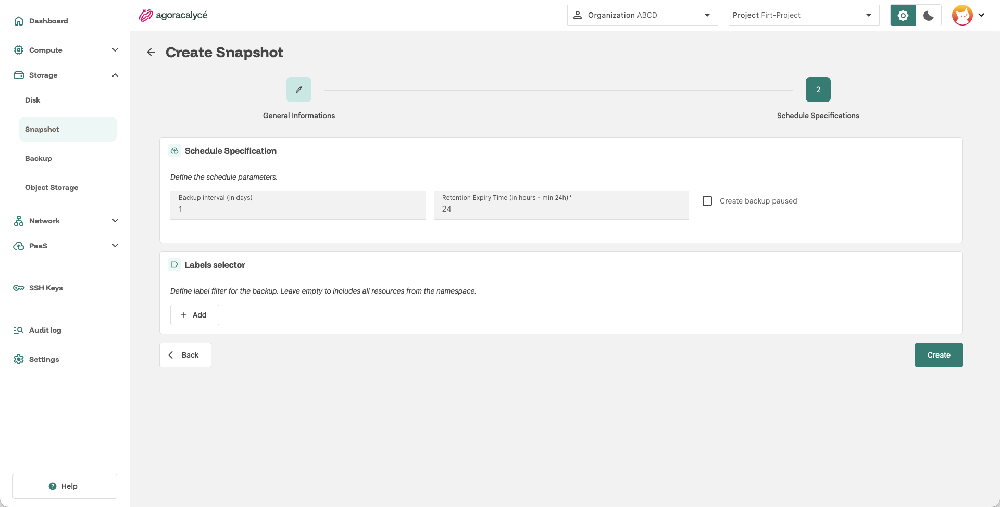
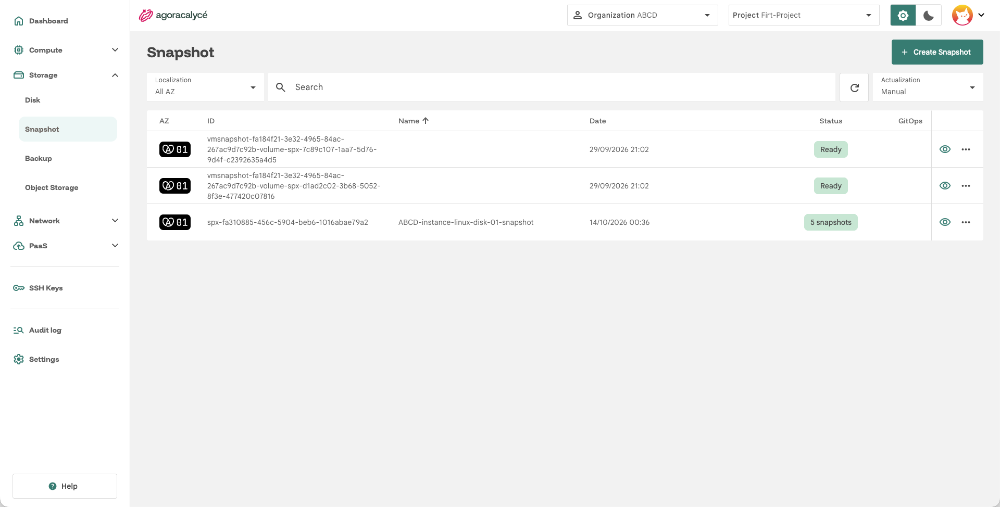

# Snapshot de disque

!!! note "Snapshot de disque ou snapshot d'instance"

    À ne pas confondre avec le [snapshot d'instance](../01-instance/04-creation-snapshot.md) (qui capture la VM entière). Un **snapshot de disque** capture uniquement un volume (disque) donné, à un instant T.

## Créer un snapshot ponctuel

1. Depuis la liste **Storage > Disk**, ouvrez le disque à sauvegarder.
2. Ouvrez le menu d'actions et cliquez sur **Create Snapshot**.

    

3. Renseignez le **nom du snapshot**, puis confirmez.

## Planifier des snapshots récurrents (Snapshot Schedule)

Une **Snapshot Schedule** automatise la création de snapshots pour un disque selon un planning récurrent (par ex. via une expression cron), avec une politique de rétention pour purger automatiquement les anciens snapshots.

1. Depuis la page de détail de création du snapshot, cochez **Scheduled**
2. Allez sur l'onglet **Schedule Specifications**
3. Configurez la fréquence et la rétention souhaitées.

    

4. Créez le snapshot

## Consulter et restaurer

Menu **Storage > Snapshot** liste tous les snapshots de disque du projet, y compris ceux issus d'une planification (regroupés sous leur schedule parente).

Depuis un snapshot, vous pouvez :

- **créer un disque** à partir de celui-ci, voir [Type de source "Snapshot"](01-creation-disque.md#type-de-source-source-type-selection)
- le **supprimer**.