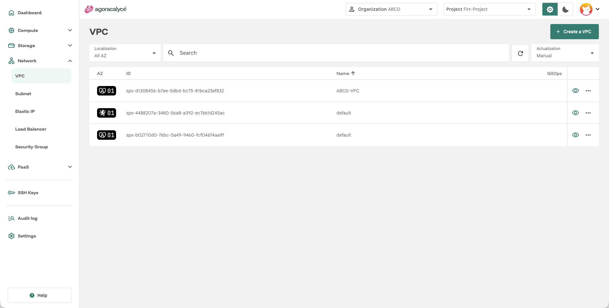
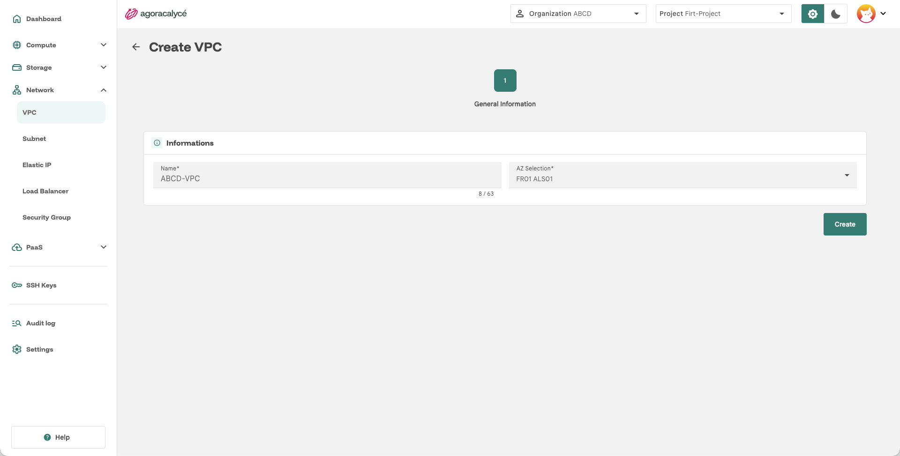

# VPC

Un **VPC** (réseau privé virtuel) isole les ressources réseau d'un projet. C'est la première brique à créer avant un [subnet](02-creer-subnet.md).

Au sein d'un même VPC, les subnets peuvent communiquer entre eux nativement.

!!! note "Pas de communication directe entre VPC"

    Deux subnets appartenant à des VPCs différents ne peuvent pas communiquer directement. La seule voie possible est de passer par Internet.

## Étape par étape

1. Menu **Network > VPC**.

    

2. Cliquez sur **Create a VPC**.
3. Renseignez :

    

    - **Name** : nom du VPC.
    - **AZ Selection** : zone de disponibilité.

4. Cliquez sur **Create**.

La création d'un VPC ne comporte qu'une seule étape : pas de configuration réseau supplémentaire à ce stade, celle-ci se fait au niveau du [subnet](02-creer-subnet.md).

## Après la création

- La page de détail d'un VPC comporte un onglet **Subnets** et un onglet **Route Table**, où vous pouvez ajouter des routes statiques pour diriger le trafic vers une appliance ou une passerelle.
- Au sein d'un VPC, deux subnets ne peuvent pas avoir des CIDR qui se chevauchent.
- **Suppression** : un VPC ne peut pas être supprimé tant qu'il contient des subnets. Supprimez-les ou migrez-les d'abord.
- **AZ** : l'AZ d'un VPC est choisie à la création et ne peut plus être modifiée.