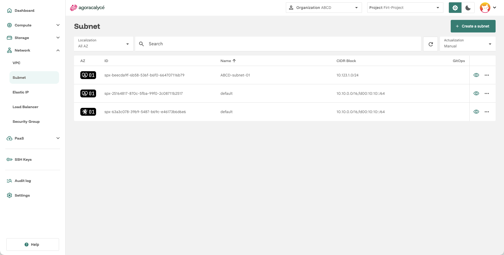
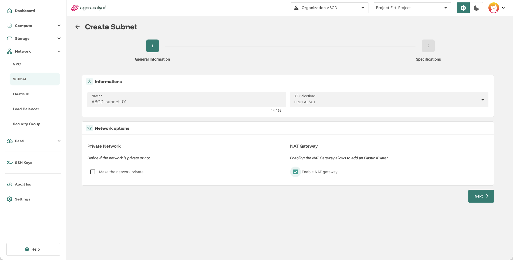
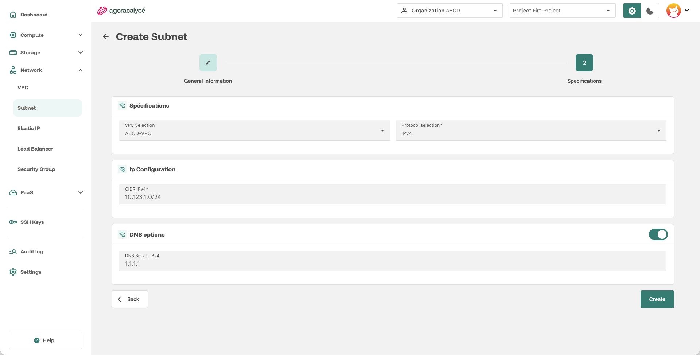

# Subnet

Un **subnet** est une sous-division d'un [VPC](01-creer-vpc.md) : c'est le réseau concret auquel sont rattachées les ressources (instances, EIP…), avec sa propre plage d'adresses (CIDR). Un VPC peut contenir plusieurs subnets.

La passerelle par défaut du subnet est rattachée au VPC.

### CIDR autorisés

Le CIDR du subnet ne peut pas être choisi librement : seules certaines plages sont autorisées par la plateforme (adresses privées / à usage spécial, non routables publiquement) :

- IPv4 : `10.0.0.0/8`, `172.16.0.0/12`, `192.168.0.0/16`, `224.0.0.0/4`, `240.0.0.0/4`
- IPv6 : `fc00::/7` (ULA), `64:ff9b:1::/48` (NAT64)

Toute plage en dehors de ces blocs est rejetée à la création.

### NAT Gateway

Une **NAT Gateway** donne au subnet une sortie vers l'extérieur (Internet) en traduisant les adresses privées des ressources vers une adresse publique, sans les exposer individuellement. C'est aussi le préalable indispensable pour associer une [EIP](03-creer-eip.md) au subnet.

Ainsi le trafic est redirigé de la façon suivante :
```
VM -> Default Gateway -> NAT Gateway -> Internet
```

### Private Network

Un subnet en **Private Network** n'expose pas directement ses ressources vers l'extérieur : le trafic entrant depuis l'extérieur du VPC n'est pas autorisé par défaut. Ce mode se combine indépendamment avec la NAT Gateway (ex. un subnet privé avec NAT gateway peut sortir vers Internet sans être joignable depuis l'extérieur).

!!! note "Préférer les Security Groups"

    Le mode **Private Network** est une mesure d'isolation extrême. Il est conseillé d'éviter son utilisation et d'utiliser plutôt les **Security Groups** pour n'ouvrir que les accès nécessaires.

## Prérequis

Un [VPC](01-creer-vpc.md) existant dans la même AZ.

## Étape 1 : Ouvrir la liste des subnets

Menu **Network > Subnet**.



Cliquez sur **Create a subnet**.

## Étape 2 : General Information + Network options



- **Name** : nom du subnet.
- **AZ Selection** : zone de disponibilité (doit correspondre à celle du VPC que vous allez sélectionner à l'étape suivante).

Deux options déterminent le mode réseau du subnet :

| Option | Effet |
|---|---|
| **Make the network private** (case *Private Network*) | Le subnet est privé : ses ressources ne sont pas directement exposées vers l'extérieur. |
| **Enable NAT gateway** (case *NAT Gateway*) | Active une passerelle NAT sur le subnet. **Nécessaire pour pouvoir associer une EIP plus tard**, voir [Créer une EIP](03-creer-eip.md). |

Ces deux cases sont indépendantes : vous pouvez par exemple avoir un subnet privé **avec** NAT gateway (sortie Internet possible sans exposition entrante), ou un subnet public sans NAT.

Cliquez sur **Next**.

## Étape 3 : Specifications



- **VPC Selection** : le [VPC](01-creer-vpc.md) auquel rattacher ce subnet.
- **Protocol selection** : `IPv4`, `IPv6` ou `Dual` (les deux).
- **CIDR IPv4** / **CIDR IPv6** : plage(s) d'adresses du subnet (ex. `10.10.0.0/16`), affichée(s) selon le protocole choisi.
- **DNS options** (bascule à activer) : serveurs DNS personnalisés (IPv4 et/ou IPv6) si vous ne voulez pas des résolveurs par défaut de la plateforme.

Cliquez sur **Create**.

## Adresses réservées par la plateforme

L'IPAM n'attribue jamais deux adresses de la plage à une VM :

- la **première** adresse, utilisée par la passerelle du subnet (par exemple `10.20.0.1` pour `10.20.0.0/24`) ;
- la **dernière** adresse, utilisée par la NAT gateway lorsqu'elle est activée (par exemple `10.20.0.254`).

Un `/24` laisse ainsi 252 adresses utilisables par des VM.

!!! note "Bien dimensionner le subnet"

    Les masques `/31` et `/32` sont refusés, et un `/30` avec NAT gateway ne laisse aucune adresse disponible. Choisissez un préfixe de taille raisonnable (par exemple `/24`) et évitez tout chevauchement avec les autres subnets du VPC.

## Lire le détail d'un subnet

Après la création, la section **Specifications** affiche :

- **Block** : le CIDR saisi ;
- **Gateway IP** : première adresse de la plage, utilisée comme route par défaut par les VM ;
- **DNS Server** : résolveur distribué par DHCP (par défaut `1.1.1.1` en IPv4 et `2606:4700:4700::1111` en IPv6, sauf si vous avez renseigné les vôtres) ;
- **Parent VPC** : nom et identifiant du VPC, avec lien ;
- **NAT Gateway → LanIP** : adresse de la NAT gateway (carte présente uniquement si elle est activée).

Le champ **Private** de **General Information** indique si le subnet est privé.

## Après la création

Le subnet créé peut être :

- sélectionné à l'étape réseau d'une [création d'instance](../01-instance/01-creation-from-scratch.md#etape-5-network),
- utilisé comme cible d'une [EIP](03-creer-eip.md) (si NAT gateway activée),
- référencé par un [Security Group](05-security-group.md) pour restreindre son périmètre.

## Modifier ou supprimer un subnet

- **Modifier** : depuis la page de détail, **Options → Edit** permet de changer les options **NAT gateway** et **Private**. Le VPC, le protocole et le CIDR ne sont pas modifiables : pour changer de plage, créez un nouveau subnet et rattachez-y les VM.
- **NAT gateway** : on ne peut pas la désactiver tant qu'une [EIP](03-creer-eip.md) l'utilise. Supprimez d'abord les EIP concernées.
- **Une NAT gateway par subnet** : chaque subnet a sa propre NAT gateway et ses propres EIP.
- **Suppression** : impossible tant que des instances ou des interfaces réseau sont rattachées au subnet.