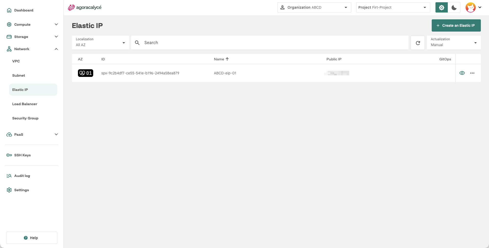
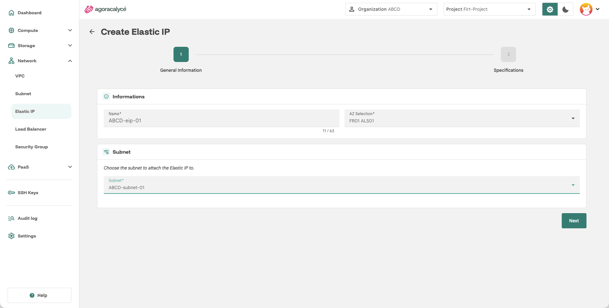
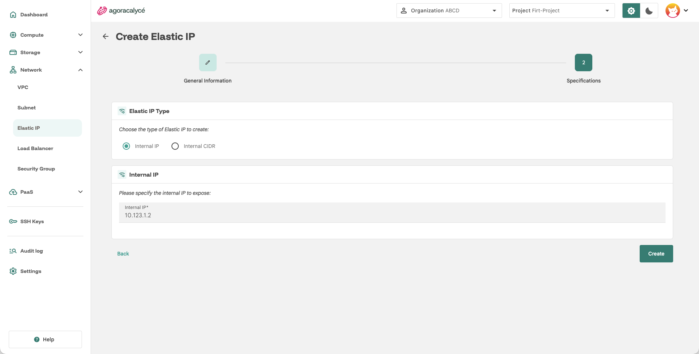
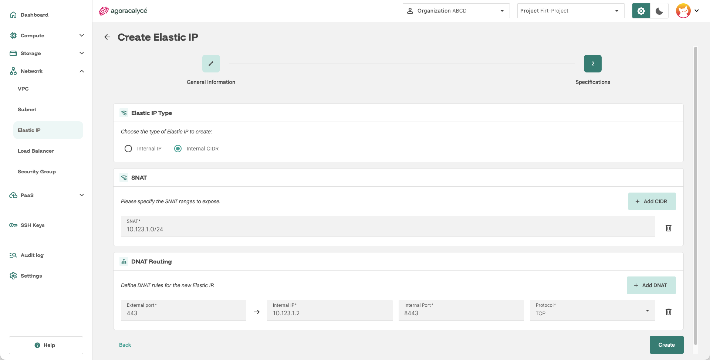

# Elastic IP

Une **Elastic IP** (**EIP**, libellé utilisé dans la Console) expose une IP sur un subnet. Elle nécessite un [subnet avec la NAT Gateway activée](02-creer-subnet.md).

## Concept : SNAT et DNAT

L'EIP en mode **Internal CIDR** repose sur deux mécanismes de traduction d'adresse (NAT), utilisables ensemble ou séparément :

- **SNAT** (*Source NAT*) : traduit l'IP **source** des ressources internes vers l'EIP quand elles initient une connexion **sortante**. Sert à donner un accès Internet sortant à des ressources privées, sans les exposer individuellement. Deux formes possibles :
    - **NAT 1-1** : une seule IP interne mappée un-pour-un sur l'EIP (option **Internal IP**, voir étape 3).
    - **NAT CIDR** : une ou plusieurs plages de subnets internes partagent la même EIP en sortie (option **Internal CIDR** → champ **SNAT**, voir étape 3).
- **DNAT** (*Destination NAT*) : traduit l'IP/port **destination** d'une connexion **entrante** arrivant sur l'EIP vers une IP/port interne précis. Sert à exposer un service interne précis (ex. rediriger le port externe 8080 vers le port 80 d'une IP interne).

En résumé : SNAT gère le trafic sortant (interne → extérieur), DNAT gère le trafic entrant (extérieur → interne).

## Étape 1 : Ouvrir la liste des EIP

Menu **Network > Elastic IP**.

Cliquez sur **Create an Elastic IP**.

## Étape 2 : General Information + association au subnet

- **Name** : nom de l'EIP.
- **AZ Selection** : zone de disponibilité.
- **Subnet** : c'est ici que l'EIP est **associée à un subnet** : sélectionnez le subnet cible dans la liste déroulante (uniquement les subnets avec NAT gateway activée apparaissent comme pertinents).

!!! note "Le champ Subnet reste vide ?"

    Sélectionnez d'abord une AZ, et vérifiez qu'un [subnet avec NAT gateway](02-creer-subnet.md) existe bien dans cette AZ.

Cliquez sur **Next**.

## Étape 3 : Specifications (type d'EIP)

Deux types d'EIP sont proposés via un bouton radio **EIP Type** :

### Internal IP (NAT 1-1)

Expose une seule IP interne précise, mappée un-pour-un sur l'EIP :

- **Internal IP** : l'adresse IP interne à exposer (validée au format IP).

### Internal CIDR (NAT CIDR + DNAT)

Expose une ou plusieurs plages d'adresses avec des règles de routage NAT détaillées :

- **SNAT** : liste de plages CIDR (ex. `10.0.1.0/24`) en *Source NAT*, bouton **Add CIDR** pour en ajouter plusieurs.
- **DNAT Routing** : règles de redirection de port (*Destination NAT*), bouton **Add DNAT**, avec pour chaque règle :
    - **External port** : port exposé côté EIP,
    - **Internal IP** : IP interne cible,
    - **Internal Port** : port interne cible,
    - **Protocol** : `TCP` ou `UDP`.

Cliquez sur **Create**.

!!! note "Aller plus loin : exposer un Load Balancer"

    Un usage courant du DNAT est d'exposer un [Load Balancer](04-load-balancer.md) : l'EIP redirige le port externe vers la **VIP** du LB (plage `198.18.0.0/16`), qui répartit ensuite sur les VMs. Flux : `Internet → IP publique:PORT → DNAT VIP:PORT → VM(s)`.

## Créer une EIP depuis un subnet

Depuis la page de détail d'un subnet qui possède une NAT gateway, **Options → Attach EIP** ouvre l'assistant avec l'AZ et le subnet déjà renseignés. Le reste de la procédure est identique. Un subnet sans NAT gateway n'apparaît pas dans l'assistant.

## Points d'attention

- Avec **Internal IP (NAT 1-1)**, tous les ports de l'adresse publique atteignent les mêmes ports de la VM, et le trafic sortant de la VM utilise cette adresse publique.
- Avec **Internal CIDR**, sans règle **DNAT**, l'EIP n'ouvre **aucun port entrant** : elle ne donne qu'un accès sortant à Internet.
- Deux VM d'un même subnet peuvent chacune avoir leur propre EIP.
- Supprimer l'EIP libère l'adresse publique ; la VM garde son IP privée et reste en fonctionnement.
- Une VM interne qui contacte un service via son EIP est prise en charge (*hairpin NAT*) : l'adresse source vue par le serveur est alors celle de l'EIP, et non celle du client.

!!! warning "Sans Security Group, tout le trafic passe"

    Les [Security Groups](05-security-group.md) s'appliquent en plus de la configuration de l'EIP.