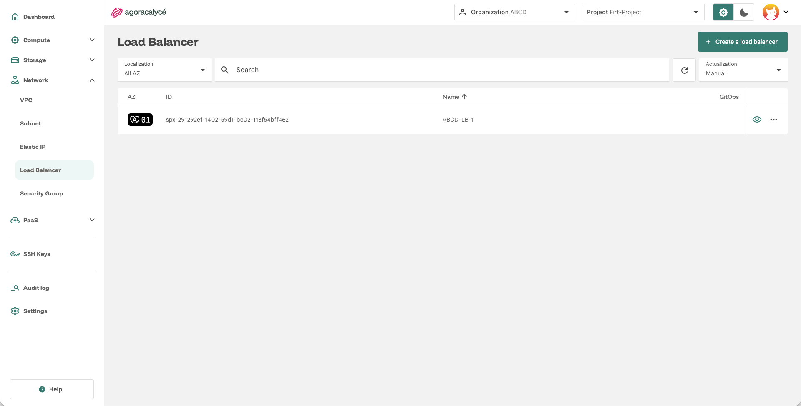
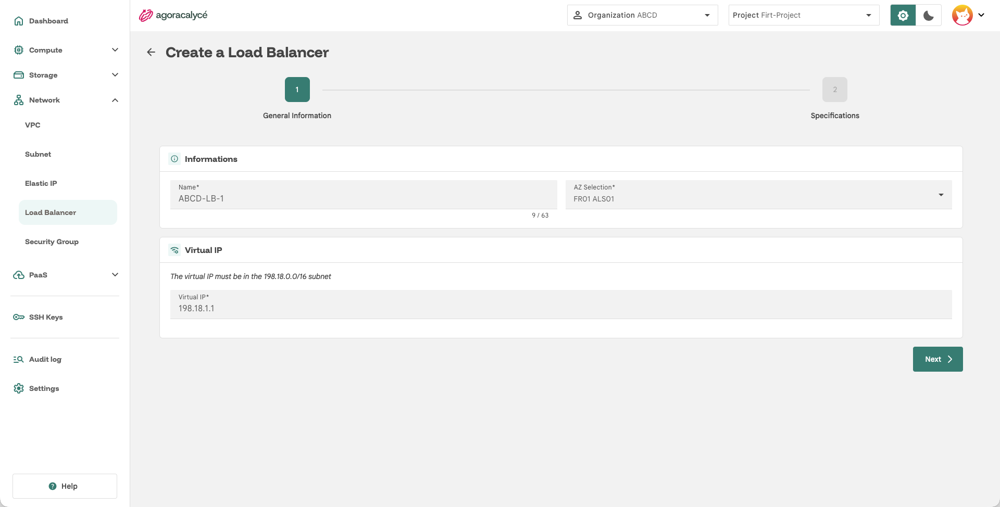
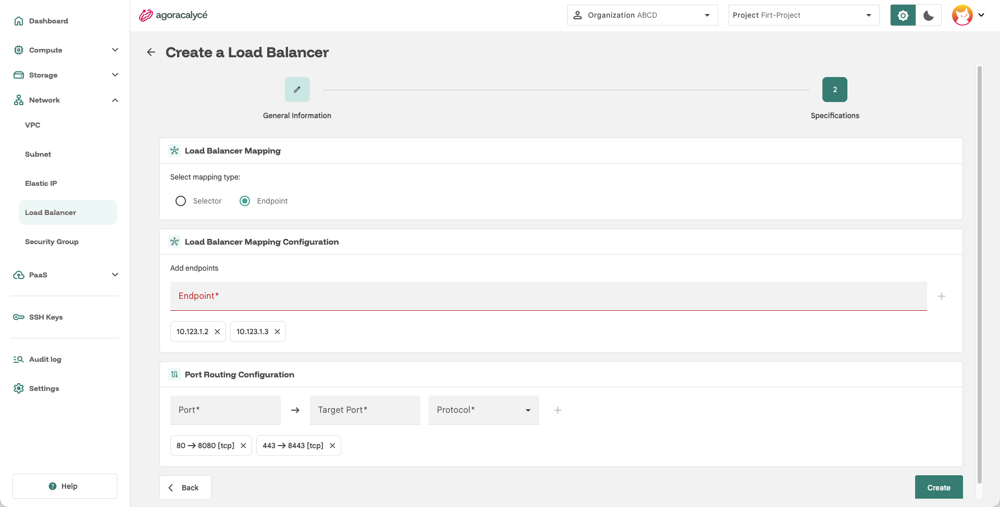

# Load Balancer

Un load balancer répartit le trafic sur un ensemble d'[instances](../01-instance/01-creation-from-scratch.md).

Le Load Balancer est un équilibreur **L3/L4** (IP/TCP/UDP) : il crée une IP unique qui redirige vers une ou plusieurs VMs. Seul l'**IPv4** est supporté.

- **Virtual IP** : choisie par l'utilisateur dans la plage réservée `198.18.0.0/16`.
- **Rattachement à un subnet** : le load balancer est rattaché à un [subnet](02-creer-subnet.md) précis. Grâce au routage du VPC, toutes les VM du VPC peuvent y accéder, même si elles ne sont pas dans ce subnet.
- **Ciblage des backends** : deux méthodes possibles pour désigner les VM cibles : IP statique manuelle, ou **sélection par label** (voir [Load Balancer Mapping](#load-balancer-mapping) ci-dessous).

La **sélection par label** est recommandée : elle redirige automatiquement le trafic vers toute VM portant le label, sans connaître ses IP à l'avance, et intègre les nouveaux backends sans reconfiguration.

!!! warning "Limite : un seul subnet par Load Balancer"

    Un `labelSelector` doit correspondre à un **subnet unique**. Seule la **première interface réseau** de chaque VM peut être utilisée pour le Load Balancer, pas ses interfaces secondaires. Toutes les VM derrière un même Load Balancer doivent donc appartenir au **même subnet**.

## Étape 1 : Ouvrir la liste

Menu **Network > Load Balancer**.

Cliquez sur **Create a Load Balancer**.

## Étape 2 : General Information + Virtual IP

- **Name** : nom du load balancer.
- **AZ Selection** : zone de disponibilité.
- **Virtual IP** : l'IP virtuelle du load balancer, qui doit appartenir à la plage réservée indiquée à l'écran (ex. `198.18.0.0/16`).

Cliquez sur **Next**.

## Étape 3 : Specifications (mapping et ports)

### Load Balancer Mapping

Choisissez le mode de ciblage des instances backend :

- **Selector** : cible les instances par **label** (voir les labels définis à la création d'une [instance](../01-instance/01-creation-from-scratch.md#etape-2-general-information)). Toute instance portant le(s) label(s) configuré(s) rejoint automatiquement le pool.
- **Endpoint** : cible des IP fixes saisies manuellement (champ **Endpoint**, bouton **+** pour ajouter chaque IP à la liste).

### Port Routing Configuration

Pour chaque règle de routage à ajouter :

- **Port** : port d'entrée sur le load balancer.
- **Target Port** : port de destination sur les instances backend.
- **Protocol** : `TCP` ou `UDP`.

Cliquez sur le bouton **+** pour ajouter la règle à la liste, répétez pour chaque port à router, puis cliquez sur **Create**.

## Fonctionnement et limites

- **Sondes de santé** : la plateforme sonde les backends et retire du pool ceux qui ne répondent plus. Les adresses source des sondes proviennent du subnet auquel le Load Balancer est rattaché.
- **Protocoles** : TCP et UDP, ainsi que SCTP selon la version de la plateforme.
- **AZ** : l'IP virtuelle et les backends doivent se trouver dans la même AZ.
- **Load Balancers de clusters Kubernetes** : ceux qui sont créés et gérés par un cluster (par exemple pour son ingress) sont protégés contre les modifications manuelles dans la Console.
- **Selector ou Endpoint** : le mode **Selector** suit automatiquement les VM qui portent le label (recommandé pour les charges qui évoluent) ; le mode **Endpoint** vise une liste fixe d'adresses IPv4 (systèmes à IP fixe, équipements externes).