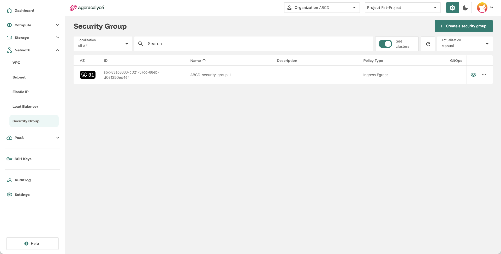
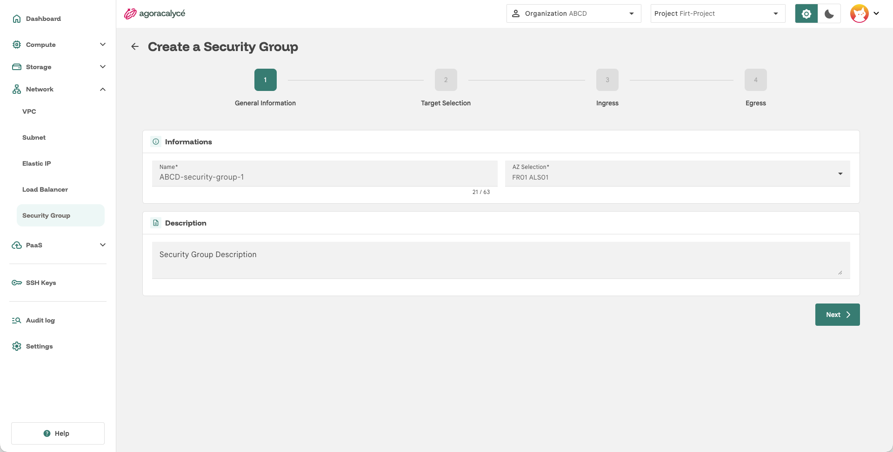
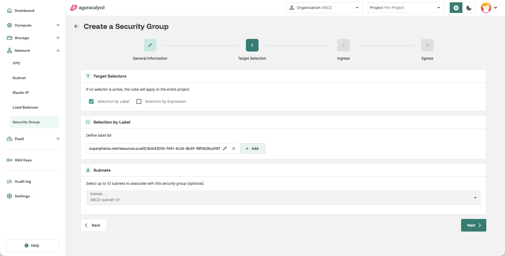
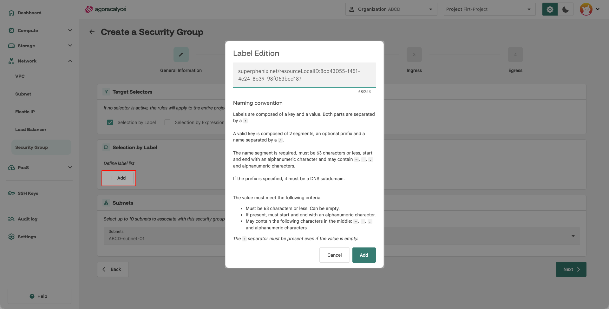
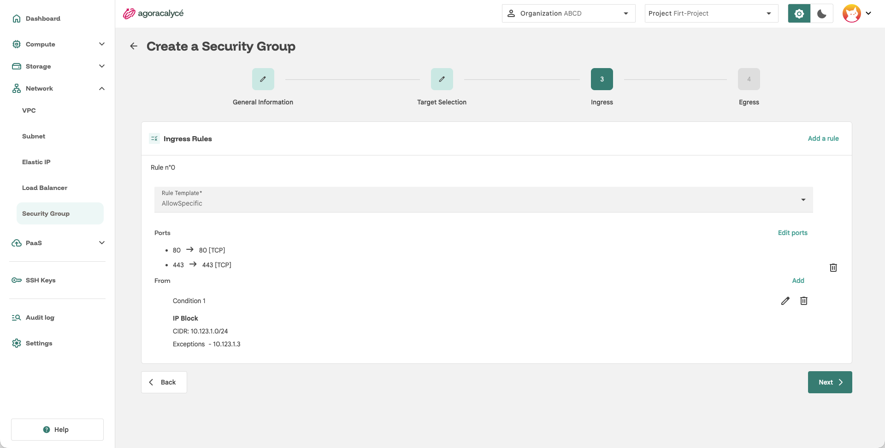
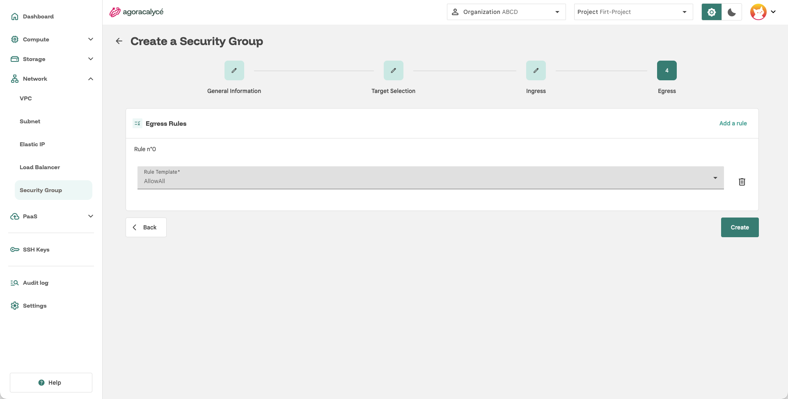

# Security Group

Un Security Group est un ensemble de règles de pare-feu (ingress/egress) appliqué à un périmètre d'[instances](../01-instance/01-creation-from-scratch.md) et/ou de [subnets](02-creer-subnet.md).

## Étape 1 : Ouvrir la liste

Menu **Network > Security Group**.

Cliquez sur **Create a Security Group**. L'assistant comporte 4 étapes.

## Étape 2 : General Information + Description

- **Name** : nom du security group.
- **AZ Selection** : zone de disponibilité.
- **Security Group Description** (optionnel) : texte libre décrivant l'usage du groupe.

Cliquez sur **Next**.

## Étape 3 : Target Selection (à qui s'appliquent les règles)

Par défaut (aucun sélecteur actif), les règles s'appliquent à **l'ensemble du projet**. Pour restreindre le périmètre :

- **Selection by Label** : les règles ne s'appliquent qu'aux ressources portant les labels indiqués (ex. les instances créées avec ce label, voir [étape 2](../01-instance/01-creation-from-scratch.md#etape-2-general-information)).
- **Selection by Expression** : sélection avancée par expression de correspondance (clé, opérateur, valeurs).
- **Subnets** (jusqu'à 10) : restreint également l'application du groupe à des [subnets](02-creer-subnet.md) précis de l'AZ sélectionnée.

Cliquez sur **Next**.

!!! warning "Saisir le préfixe des labels"

    La Console ajoute automatiquement le préfixe `user.superphenix.net/` aux labels personnalisés d'une instance. Un label saisi `role:web` à la création de la VM devient donc `user.superphenix.net/role:web`. Dans **Selection by Label**, saisissez la clé **complète**, préfixe compris : cette fenêtre n'ajoute pas le préfixe pour vous.

Chaque security group ajoute aussi automatiquement à sa cible un label d'identifiant de projet (qui garde les règles à l'intérieur de votre projet) et une expression qui exclut les composants de la plateforme de la politique : ils apparaissent dans le détail, à côté de votre label.

## Étape 4 : Ingress (trafic entrant)

Cliquez sur **Add a rule** pour chaque règle entrante. Pour chaque règle, un **modèle de règle** (Rule Template) est proposé :

- Des modèles rapides prédéfinis `AllowAll` ou `DenyAll`.
- **Allow Specific**, pour une configuration fine :
    - **Ports** : bouton **Edit ports** pour définir une ou plusieurs plages `port → endPort` avec leur protocole.
    - **From** : bouton **Add** pour définir une ou plusieurs conditions source, au choix :
    - par **label** (Match Labels) ou **expression** (Match Expressions) sur des ressources du projet,
    - par **IP Block** : un CIDR source, avec exceptions optionnelles.

Cliquez sur **Next**.

## Étape 5 : Egress (trafic sortant)

Fonctionnement identique à l'étape Ingress, mais pour le trafic sortant (le champ équivalent à "From" s'appelle **To**, la destination).

Le bouton **Create** devient actif une fois les 4 étapes valides. Cliquez dessus pour créer le security group.

Si le security group appartient à un cluster Kubernetes, l'action **See cluster** du menu de sa page de détail ouvre le cluster parent (droit de lecture KaaS requis).

## Comportement des règles

- **Plusieurs groupes sur une même VM** : le trafic est accepté dès qu'au moins un des groupes l'autorise.
- **Une règle d'ingress suffit à fermer tout le reste** : avec uniquement TCP 80 ouvert, la VM refuse tout autre trafic entrant. Les paquets **ICMP** et **DHCP** restent autorisés sur tous les groupes, donc `ping` répond toujours.
- **Egress** : sans règle d'egress, le trafic sortant reste ouvert tant que le groupe contient au moins une règle d'ingress. Pour le fermer, ajoutez une règle `DenyAll` puis des règles `AllowSpecific` pour ce que la VM peut joindre.
- **Groupe sans aucune règle** : le trafic entrant est bloqué (**Deny All** affiché sous **Ingress**) et le trafic sortant reste ouvert. À l'inverse, un groupe qui n'a que des règles d'egress laisse l'entrant ouvert.
- **Suivi de connexion** : les groupes sont *stateful*. Le retour d'une connexion autorisée est accepté automatiquement.
- **Conditions d'une règle** : une règle avec des ports et sans source (**From** vide) accepte ces ports depuis n'importe quelle adresse. **Ip Block** vise un CIDR (avec **Exception** pour en exclure des adresses) ; **Pod Selection** vise d'autres VM du projet par label ou expression. Une règle avec plusieurs conditions accepte le trafic qui en satisfait au moins une.
- **Modifier et supprimer** : **Options → Edit** rouvre l'assistant avec les valeurs actuelles. Supprimer un groupe retire ses règles des VM concernées, qui continuent de fonctionner. Pour inclure une VM, ajoutez-lui le label ; pour l'exclure, retirez-le.
- **Groupes de clusters Kubernetes** : ceux créés par la plateforme pour un cluster sont visibles (interrupteur **See clusters**) mais ne peuvent être ni modifiés ni supprimés.
