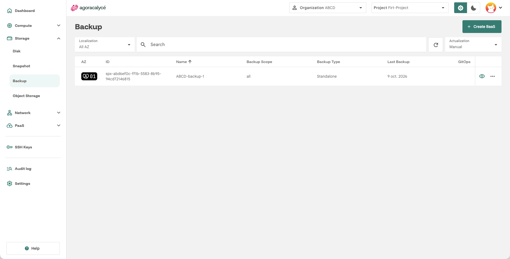
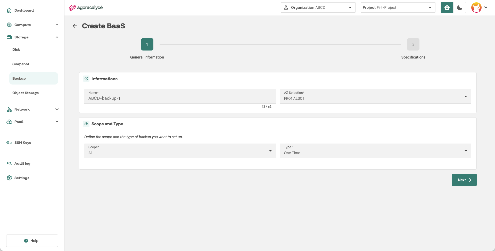

# Faire une sauvegarde (BaaS)

Le **Backup as a Service** (BaaS) sauvegarde des ressources du projet (VM et/ou tout le namespace), ponctuellement ou selon un planning récurrent.

## Étape 1 : Ouvrir la liste

Menu **Storage > Backup**.

Cliquez sur **Create a Backup**.

## Étape 2 : General Information + Scope and Type

- **Name** : nom de la sauvegarde.
- **AZ Selection** : zone de disponibilité.
- **Scope** :
    - `All` : sauvegarde tout le namespace du projet dans l'AZ.
    - `VM` : sauvegarde ciblée sur une ou des VM précises (via sélection de labels à l'étape suivante).
- **Type** :
    - `One Time` : sauvegarde unique, exécutée une fois.
    - `Scheduled` : sauvegarde récurrente selon un planning.

!!! note "Une seule sauvegarde planifiée `All` par AZ"

    Il ne peut exister qu'une seule sauvegarde planifiée de scope `All` par AZ et par projet.

Cliquez sur **Next**.

## Étape 3 : Specifications

Si **Type = Scheduled**, un bloc supplémentaire apparaît :

- **Backup interval (in days)** : fréquence de la sauvegarde, entre 1 et 7 jours.
- **Retention Expiry Time (in hours)** : durée de conservation avant suppression automatique, entre 24 et 960 heures (minimum 24h).
- **Create backup paused** : case à cocher pour créer la planification à l'état pause (ne démarre pas immédiatement).

Dans tous les cas (One Time ou Scheduled) :

- **Labels selector** : filtre par label pour cibler précisément les ressources à inclure dans la sauvegarde. Laissé vide, la sauvegarde inclut toutes les ressources du namespace (scope `All`) ou de la VM ciblée (scope `VM`).

Cliquez sur **Create**.

## Restaurer une sauvegarde

Depuis la liste **Storage > Backup**, ouvrez une sauvegarde terminée pour accéder aux actions de restauration disponibles depuis sa page de détail.