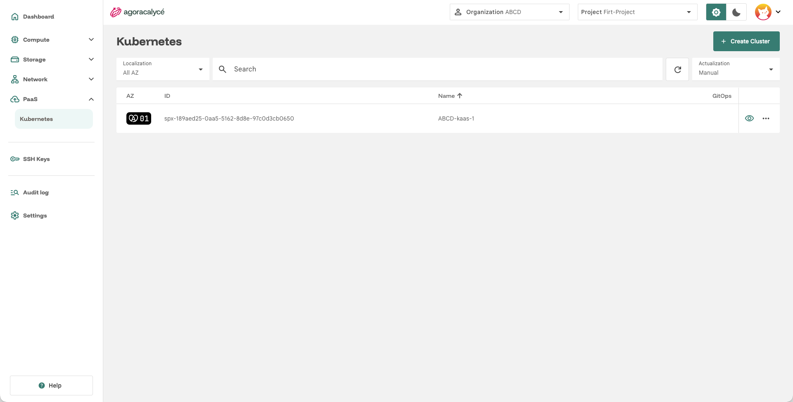
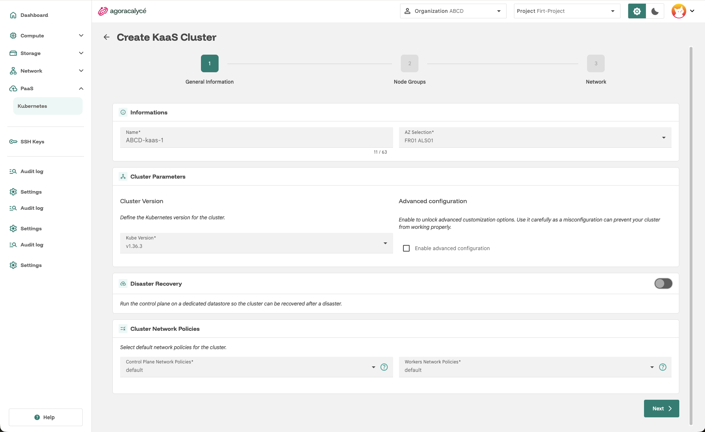
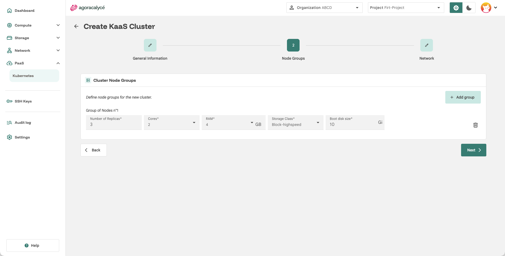
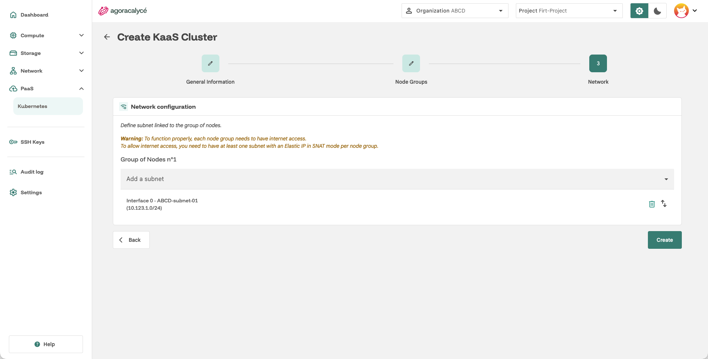

# Créer un cluster

**Kubernetes-as-a-Service** est le service de provisionnement de clusters Kubernetes de la plateforme. Cette page décrit la création d'un cluster en trois étapes : **General Information**, **Node Groups** et **Network**.

Les autres opérations sont détaillées dans :

- [Accéder au cluster](02-acceder-cluster.md)
- [Exposer le cluster](03-exposer-cluster.md)
- [Mettre à jour le cluster](04-mettre-a-jour-cluster.md)

## Ordre de création des ressources

L'ordre est contraint : chaque étape a besoin d'un identifiant produit par la précédente.

```
VPC → Subnet → Cluster Kubernetes → Load Balancer → Elastic IP
```

| # | Ressource | Pourquoi cet ordre |
|---|---|---|
| 1 | **VPC** | Porte le réseau du cluster. |
| 2 | **Subnet** | Doit avoir un accès Internet (NAT Gateway + SNAT ou Floating IP). |
| 3 | **Cluster Kubernetes** | Déployé dans ce subnet. Génère l'`effectiveId` du cluster. |
| 4 | **Load Balancer** | Le mapping de type *Selector* a besoin de l'`effectiveId` du cluster (`cluster.x-k8s.io/cluster-name`). |
| 5 | **Elastic IP** | DNAT vers l'IP du Load Balancer, qui doit donc exister avant. |

Les étapes 4 et 5 sont détaillées dans [Exposer le cluster](03-exposer-cluster.md).

## Prérequis

- Un [VPC](../../04-utilisation/03-network/01-creer-vpc.md) et un [subnet](../../04-utilisation/03-network/02-creer-subnet.md) avec accès Internet.
- Le droit **KaaS Write** sur le projet (création, modification et suppression d'un cluster).

!!! note "SNAT obligatoire sur le subnet"

    **Le SNAT doit être configuré sur le subnet** : sans lui, les nœuds ne peuvent pas joindre leur control plane.

## Ouvrir le formulaire de création

Menu **PaaS > Kubernetes** : la liste des clusters s'affiche. Cliquez sur **+ Create Cluster**.



## Étape 1 : General Information



- **Name** : nom du cluster.
- **AZ** : zone de disponibilité (doit être celle du VPC et du subnet).
- **Cluster version** : version de Kubernetes du cluster. Seules les versions proposées par la plateforme sont disponibles.

L'étape comporte aussi les sections **Disaster Recovery** et **Cluster Network Policies**.

### Disaster Recovery

Par défaut, le control plane utilise un datastore (etcd) mutualisé. Activer **Disaster Recovery** lui attribue un **datastore dédié**, stocké sur un volume persistant :

- **Storage class** : classe de stockage du volume. Par défaut, la première classe configurée sur la plateforme.
- **Storage** : taille du volume en Go (**8 Go par défaut**). Elle peut être augmentée par la suite, jamais réduite.

!!! note "Contraintes du Disaster Recovery"

    - Kubernetes **1.35 ou supérieur** est requis.
    - Activer ou désactiver le datastore dédié **et** changer de version Kubernetes ne peuvent pas se faire dans la même mise à jour : voir [Mettre à jour le cluster](04-mettre-a-jour-cluster.md).

### Cluster Network Policies

Par défaut, la plateforme déploie des network policies qui garantissent : control plane joignable de partout, communication entre workers, accès Internet des nœuds (téléchargement d'images) et, en mode `default`, accès aux nœuds par des VM non-workers du subnet ou extérieures selon la configuration réseau. Elles se règlent séparément pour le control plane et les workers :

| Cible | Valeurs | Défaut |
|---|---|---|
| **Control plane** | `default`, `none` | `default` **NE PAS MODIFIER CETTE VALEUR** |
| **Workers** | `default`, `strict`, `none` | `default` |

Cas d'usage : 

| Network Policies | Description |
|---|---|
| `default` | Tous les flux sont ouverts en Ingress et Egress. |
| `strict` | Tous les flux sont fermés pour l'Ingress et ouverts pour l'Egress. |
| `none` | Aucune policy n'est déployée : vous définissez vos propres règles de pare-feu (par exemple via un [Security Group](../../04-utilisation/03-network/05-security-group.md)). |

Les composants se ciblent avec ces labels :

| Composant | Label |
|---|---|
| Control plane | `superphenix.net/resourceEffectiveID: <effectiveId du cluster>` et `superphenix.net/workloadClass: kaas-tenant-api-server` |
| Workers | `cluster.x-k8s.io/cluster-name: <effectiveId du cluster>` |

Cliquez sur **Next**.

## Étape 2 : Node Groups



Un **node group** est un ensemble de workers partageant le même dimensionnement. Un cluster peut compter **jusqu'à 5** node groups, chacun de **1 à 10** workers.

| Champ | Description |
|---|---|
| **Name** | Nom du groupe (caractères autorisés : lettres, chiffres et `-`). |
| **Number of Replicas** | Nombre de workers du groupe, **de 1 à 10**. |
| **Cores** | vCPU par nœud : `1`, `2`, `4`, `8`, `16` ou `32`. |
| **RAM** | Mémoire par nœud, en Go : `1`, `2`, `4`, `8`, `16`, `32` ou `64`. |
| **Classe de stockage** | Sélectionner la classe de stockage disponible dans l'AZ. |
| **Boot disk size** | Taille du disque du nœud (containerd, kubelet…), pas celle du bootloader. **40 Go minimum recommandés** (1 Go est le minimum accepté). |

Le dimensionnement s'applique à tous les nœuds du groupe. Cliquez sur **Next**.

## Étape 3 : Network



Sélectionnez le **subnet** de rattachement des nœuds : il doit avoir un accès Internet (voir [Créer un subnet](../../04-utilisation/03-network/02-creer-subnet.md)) avec un SNAT configuré.

Un node group peut être rattaché à plusieurs subnets : chacun devient une interface réseau des nœuds, dans l'ordre indiqué.

## Configuration avancée (optionnelle)

Dans **Cluster Parameters**, cochez **Enable advanced configuration** pour accéder à :

- **KaaS Essentials** : valeurs Helm (YAML) personnalisées pour les composants de base installés dans le cluster : **CoreDNS**, **Cilium** et **Metrics Server**. Les classes de stockage et de snapshot du cluster sont, elles, configurées automatiquement.
- **Post Installation Chart** : un chart Helm installé automatiquement à l'initialisation du cluster. Renseignez **Chart Name**, **Chart Version**, **Namespace**, **Repository Url** et, via **Edit values**, les valeurs YAML du chart.

Les valeurs YAML invalides sont rejetées à la validation.

Cliquez sur **Create**. Son accès est décrit dans [Accéder au cluster](02-acceder-cluster.md).
