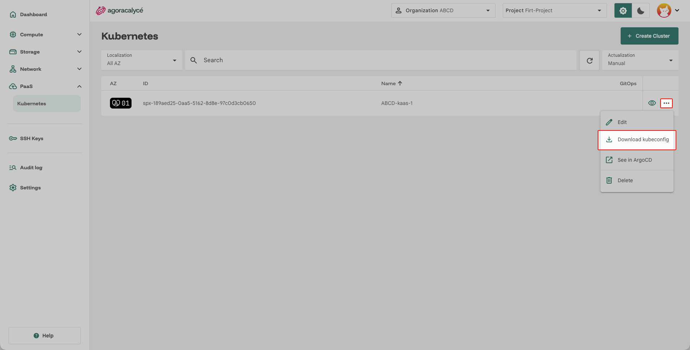
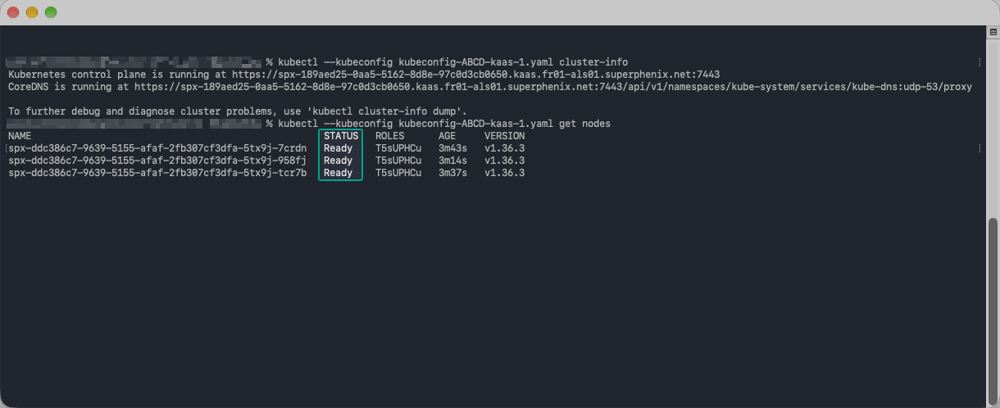

# Accéder au cluster

Une fois le cluster [créé](01-creer-cluster.md), l'accès se fait avec un fichier **kubeconfig** téléchargé depuis la Console.

## Droits nécessaires

Le téléchargement exige les droits **KaaS Read** et **KaaS KubeConfig** sur le projet (ensemble de droits *KaaS Cluster Access* ou *KaaS Full Access*). Voir [Users / Groups / Droits](../../03-administration/04-users-groups-droits.md).

## Télécharger le kubeconfig

Menu **PaaS > Kubernetes** : sur la liste des clusters, sélectionnez le cluster puis **… > Download kubeconfig**.




## Vérifier l'accès

```bash
kubectl --kubeconfig /chemin/du/kubeconfig cluster-info
kubectl --kubeconfig /chemin/du/kubeconfig get nodes
```

Les nœuds doivent apparaître à l'état `Ready`.



!!! note "Accès direct au control plane"

    Le kubeconfig pointe vers l'adresse publique (FQDN) du control plane de la zone de disponibilité : le cluster est joignable sans passer par le Load Balancer ni l'EIP décrits dans [Exposer le cluster](03-exposer-cluster.md), qui servent uniquement aux applications.

!!! warning "Kubeconfig confidentiel"

    Le fichier donne un accès administrateur au cluster : conservez-le comme un secret.
