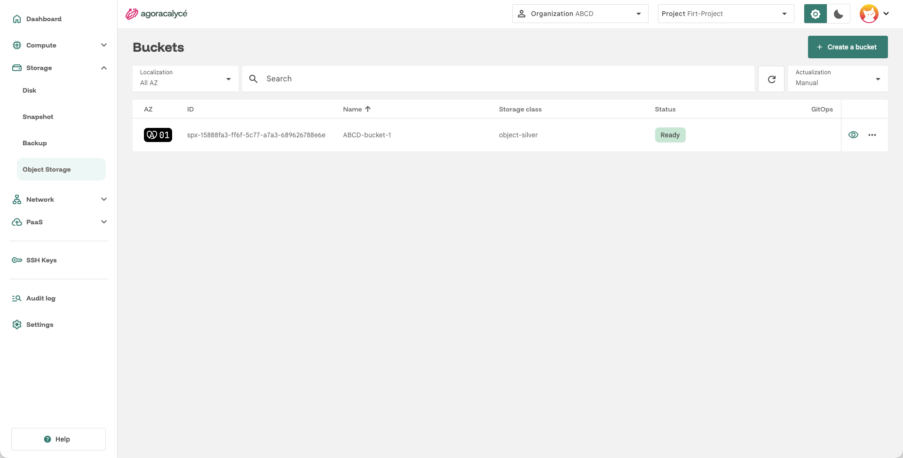
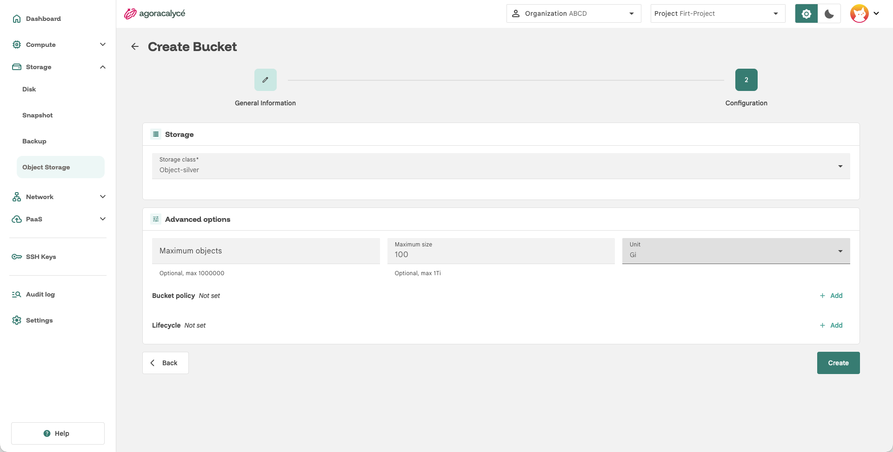

# Création d'un bucket

L'**Object Storage** est distinct du stockage bloc (voir [Storage](../04-utilisation/02-storage/01-creation-disque.md)) : il expose des **buckets** compatibles **S3**, adaptés au stockage de fichiers/objets plutôt qu'au montage sur une instance.

## Étape 1 : Ouvrir la liste des buckets

Menu **Storage > Object Storage**.



Cliquer sur **Create a bucket**.

## Étape 2 : General Information

- **Name** : nom du bucket. Différent **Bucket Name** utilisé par les API S3, généré par la console d'Agora Calyce.
- **AZ Selection** : zone de disponibilité.

## Étape 3 : Configuration



- **Storage class** : `Object-silver` (Seule classe disponible à ce jour).
- **Max objects** : nombre maximum d'objets autorisés dans le bucket.
- **Max size** : taille maximale du bucket (ex. `100Gi`).
- **Bucket policy** : policy S3 (JSON) appliquée au bucket.
- **Lifecycle** : règles de cycle de vie S3 (JSON). Exemple : expiration automatique d'objets après N jours.

!!! note "Bucket policy et Lifecycle"

    Pour la configuration avancée de **Bucket policy** et **Lifecycle**, voir [Configuration Avancée Bucket](./02-configuration-avancee-bucket.md).

## Récupérer les accès S3

Depuis la page de détail du bucket, un onglet **Connect** expose :

- **Endpoint** : URL du endpoint S3 à utiliser côté client.
- **Bucket name** : UUID du bucket dans la console d'Agora Calyce.
- **Region** : zone de disponibilité où provisionner le bucket.
- **Access key** / **Secret key** : identifiants générés pour l'accès admin du bucket.

Ces informations permettent de configurer n'importe quel client compatible S3 pour lire/écrire dans le bucket.

On y trouve également un bouton **Download Config**, permettant d'extraire le fichier de configuration  ainsi que les credentials pour les clients AWS CLI et s3cmd.

## Utiliser le bucket avec AWS CLI

```Shell
# Déplacer la configuration téléchargée :  ~/.aws/credentials et ~/.aws/config

# Trouver l'UUID du bucket dans les détails, à la clé "Bucket name".
export BUCKET_UUID=spx-ID

# Lister les objets
aws s3 ls s3://$BUCKET_UUID/

# Ajouter un objet
aws s3 cp ./my-file s3://$BUCKET_UUID/

# Supprimer un objet
aws s3 rm s3://$BUCKET_UUID/my-file
```

Documentation officielle : [docs.aws.amazon.com/cli/latest/reference/s3](https://docs.aws.amazon.com/cli/latest/reference/s3/)

## Utiliser le bucket avec s3cmd

```Shell
# Déplacer la configuration téléchargée : ~/s3cfg

# Trouver l'UUID du bucket dans les détails, à la clé "Bucket name".
export BUCKET_UUID=spx-ID

# Lister les objets
s3cmd ls s3://$BUCKET_UUID/

# Ajouter un objet
s3cmd put ./my-file s3://$BUCKET_UUID/

# Supprimer un objet
s3cmd rm s3://$BUCKET_UUID/my-file
```

Documentation officielle : [s3tools.org/usage](https://s3tools.org/usage)

## Modifier / supprimer

Depuis la page de détail du bucket : mise à jour de la configuration (max objects, max size, policy, lifecycle), ou suppression.
