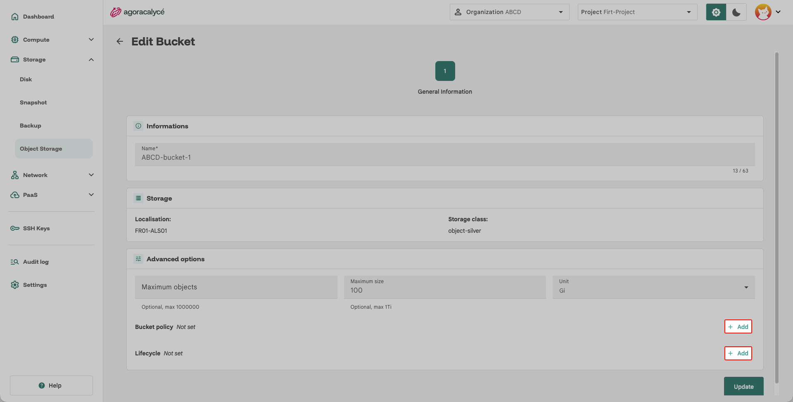

# Configuration avancée d'un bucket

1. Se rendre dans la section **Advanced options** lors de la modification du bucket (**Options->Edit**).



## Ajouter une bucket policy

1. Cliquer sur le bouton **Add** à droite de **Bucket policy**.
2. Coller la configuration en format JSON. Exemple :

    ```JSON
    {
      "Version": "2012-10-17",
      "Statement": [
        {
          "Sid": "DenyOutsideCorpNetwork",
          "Effect": "Deny",
          "Principal": "*",
          "Action": "s3:*",
          "Resource": [
            "arn:aws:s3:::spx-ID",
            "arn:aws:s3:::spx-ID/*"
          ],
          "Condition": {
            "NotIpAddress": {
              "aws:SourceIp": [
                "<ip-autorisée>/32"
              ]
            }
          }
        }
      ]
    }
    ```

3. Confirmer l'update **Update->Confirm**. La configuration est effective au bout de quelques instants.
4. Vérifier que la règle est appliquée

    ```Shell
    # AWS CLI (recommandé)
    aws s3api get-bucket-policy --bucket $BUCKET_UUID

    # s3cmd
    s3cmd info s3://$BUCKET_UUID/
    ```

## Ajouter une règle de cycle de vie (lifecycle)

1. Cliquer sur le bouton **Add** à droite de **Lifecycle**.
2. Coller la configuration en format JSON. Exemple :

    ```JSON
    {
      "Rules": [
        {
          "Filter": {
            "Prefix": ""
          },
          "Expiration": {
            "Days": 3
          },
          "Status": "Enabled",
          "ID": "Delete After 3 days."
        }
      ]
    }
    ```

3. Confirmer l'update **Update->Confirm**. La configuration est effective au bout de quelques instants.
4. Vérifier que le cycle de vie est appliqué

    ```Shell
    # AWS CLI
    aws s3api get-bucket-lifecycle --bucket $BUCKET_UUID

    # s3cmd
    s3cmd getlifecycle s3://$BUCKET_UUID/
    ```

## Ajouter une limite du nombre d'objets

Ce quota empêche la création de nouveaux objets si le nombre total d'objets est supérieur ou égal à la limite fixée.

!!! note "Aucun objet supprimé"

    Il peut être modifié à n'importe quel moment et peut être inférieur au nombre total d'objets déjà présents sans risque de destruction.

## Ajouter une taille maximum au bucket

Ce quota empêche la création de nouveaux objets si la taille totale du bucket est supérieure ou égale à la limite fixée.

!!! note "Aucun objet supprimé"

    Il peut être modifié à n'importe quel moment et peut être inférieur à la taille totale actuelle sans risque de destruction.

L'unité peut être choisie sur la console via le menu déroulant **Unit**.