# Firewalling sur la console d'Agora Calyce

L'objectif de cette page est de décrire ce qui doit être mis en place et dans quel ordre pour créer un firewall via la console.  
L'exemple sera fait avec un OpnSense mais cela fonctionne avec n'importe quel distribution.

## Architecture

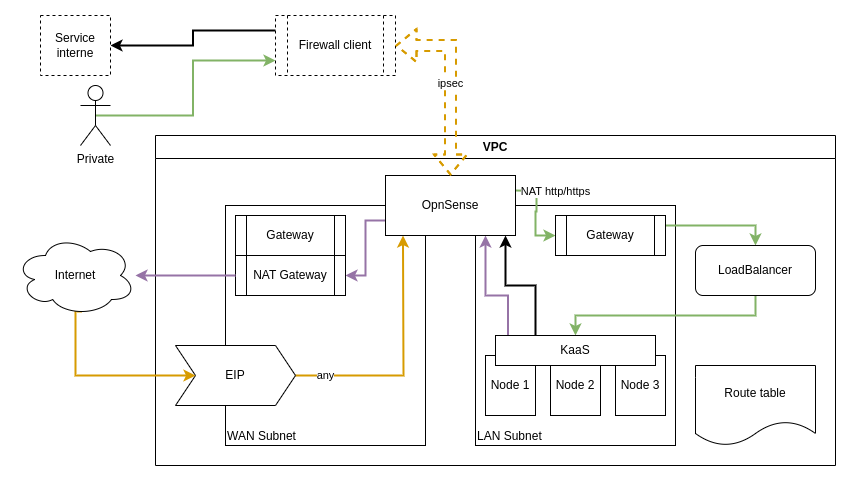

!!! info "Schéma simplifié"

    Ce schéma n'est pas forcément parfaitement exact sur les flux réseau, il a été simplifié.
    Par exemple, les flux passent tous par la gateway du subnet qui est l'élément routant.

Nous avons donc :

- Un subnet public appelé WAN
    - Une NAT Gateway dans ce subnet pour avoir accès à Internet
- Un subnet privé appelé LAN
    - Pas de NAT gateway donc, les machines devront passer par le FW pour accéder à Internet.
- Une EIP configurée en full-nat (ie elle route tout le traffic vers la patte WAN du FW)
- Une instance pour le FW avec une patte dans chaque subnet
- Un cluster KaaS pour représenté la charge de travail côté privé
- Un réseau externe hypothétique qui peut être relié via un tunnel site-a-site au FW

---

## Déploiement

Dans cette section nous allons détailler la mise en place de la plateforme ci-dessus en mode GitOps.  
Les actions pour le faire en console seront dans le même ordre.

### Réseau

- Création du VPC :
    - name = k8s
    - az = au choix
- Création du subnet public :
    - name = public-subn
    - az = au choix
    - NAT Gateway = OUI
    - vpc = k8s
    - CIDR IPv4 = "10.81.1.0/24"
- Création du subnet privé :
    - name = k8s-subn
    - az = au choix
    - NAT Gateway = NON
    - vpc = k8s
    - CIDR IPv4 = "10.96.140.0/24"
    - DNS Options > DNS Server = 10.96.140.2

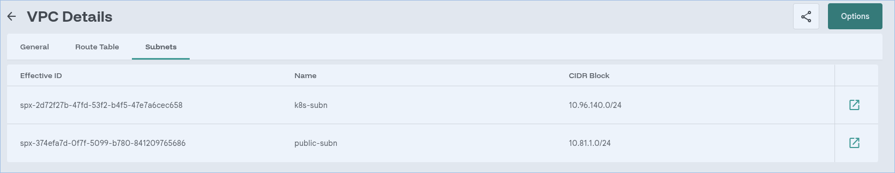

Retourner sur le VPC `k8s` et passer en modification.

- Cliquer sur "Next" puis ajouter une route statique :
    - Policy = Destination
    - CIDR = 0.0.0.0/0
    - Next Hop IP = 10.96.140.2
    - Route Table = k8s-subn

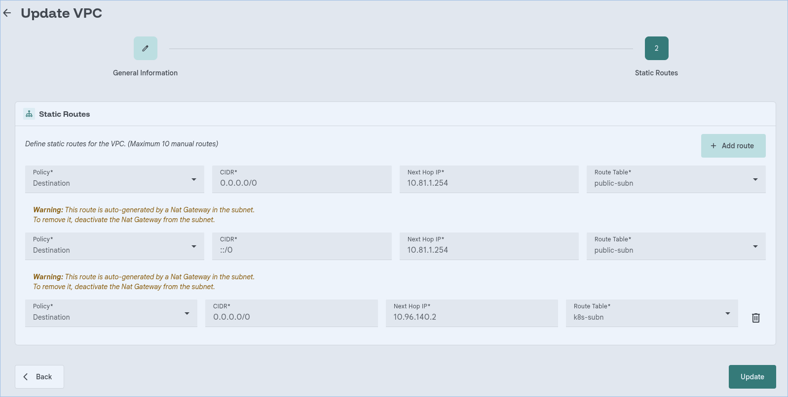

Cette modification indique à toutes les machines du subnet privé de passer par l'ip du firewall pour accéder à n'importe quelle ressource.

- Ajoutez maintenant une EIP pour exposer le firewall :
    - name = k8s
    - az = au choix
    - Subnet = public-subn
    - Elastic IP Type = Internal IP
    - Internal IP = 10.81.1.2 (IP qu'on met dans le FW à l'étape suivante)

### Instance firewall

[Voir la procédure détaillée](../04-utilisation/01-instance/02-guide-linux.md)

- Créer une instance avec les informations suivantes
    - name = firewall
    - az = au choix
    - Run Strategy = Always
    - Instance Type = linux
    - Core = 2
    - RAM = 4
    - Advanced options
        - EFI firmware = EFI
        - Secure Boot = Disable
    - CloudInit Configuration
        - Customize = OUI
        - Content = **TODO**
        - Mount type = SATA
    - Disk
        - Name = firewall-boot
        - Size = 20G
        - Storage class = Block-highspeed
        - Source = http
        - Url = https://cloud.agoracalyce.net/images/opnsense/26.1/opnsense-26.1-golden-image.qcow2
        - Mount type = SATA
    - Networks
        - subnet = public-subn
            - ipv4 = 10.81.1.2
        - subnet = k8s-subn
            - ipv4 = 10.96.140.2

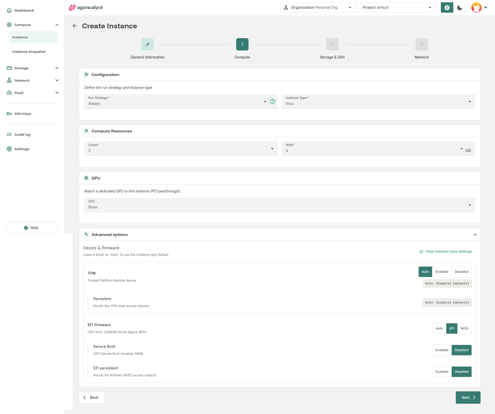

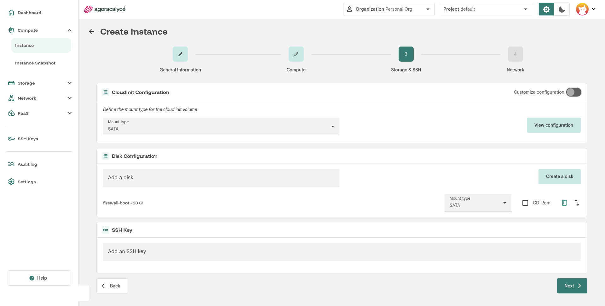

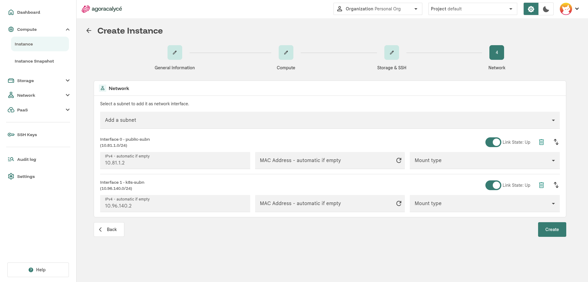

Suivre l'avancement du boot de la VM via le Serial :

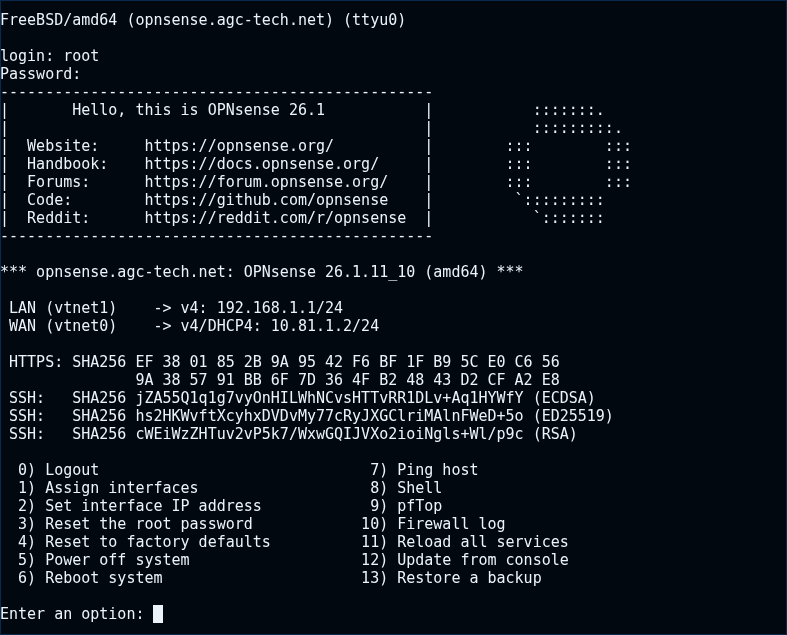

Connectez-vous avec le user et le mot de passe par défaut : `root` / `opnsense`  
Pensez ensuite à modifier immédiatement le mot de passe via l'option `3`

---

## Configuration

### OpnSense

Une fois l'instance fonctionnelle, il faut passer dans l'interface d'OpnSense pour ajouter quelques configurations.

Selon votre OS de firewall, il faudra très probablement passer par l'interface Serial sur l'instance pour réaliser la configuration initiale.  
Cette partie de la configuration n'est pas détaillée dans cette documentation car elle n'est pas spécifique à cet environnement cloud.

#### Configuration initiale

Paramétrez les interfaces WAN et LAN selon le plan d'adressage spécifié ci-dessus :

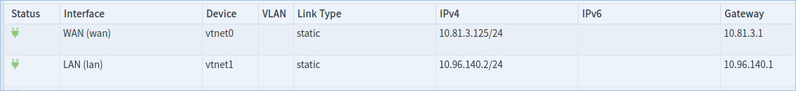

Pensez également à vérifier la présence de la règle de OutboundNAT sur le LAN :

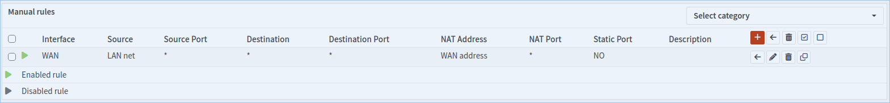

---

## Charges de travail

Nous allons dans cet exemple créer un cluster Kubernetes derrière le firewall mais le fonctionnement est identique pour des VMs.

### K8s

Voir la [page dédiée](../05-paas/01-kaas/01-creer-cluster.md) sur la création d'un KaaS

- Créer le cluster en utilisant le VPC `k8s` et le subnet `k8s-subn`.
- Attendre la fin de la création du cluster et la disponibilités dans "nodes" via kubectl.

!!! info "Le cluster ne s'initialise pas ?"

    Si le cluster n'arrive pas à s'initialiser, vérifiez la règle d'OutboundNat sur le firewall.

### Load Balancer

Voir la [page dédiée](../05-paas/01-kaas/03-exposer-cluster.md) sur l'exposition d'un cluster k8s

!!! warning "Ne pas modifier l'EIP"

    Ne pas modifier l'EIP comme indiqué sur la page, l'exposition sera faite via le firewall.

---

### Exposition

Si on souhaite exposer un service/instance déployé sur l'infrastructure, il faut le configurer dans le firewall.  
Dans notre exemple, on va exposer le LB du cluster k8s.

Pour cela, il faut retourner dans l'interface OpnSense pour réaliser l'exposition du cluster.

#### Gateway et Route sur le LAN

Il faut paramétrer la gateway du LAN dans le firewall  
Allez dans "System > Gateways > Configuration" et créez une nouvelle gateway :  
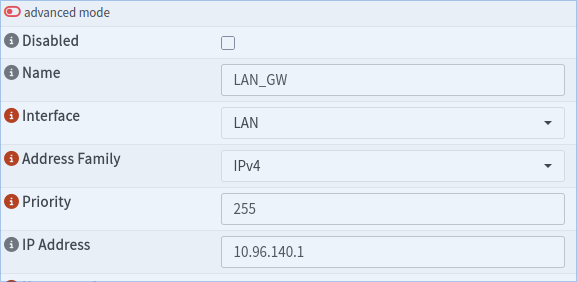

Ajoutez ensuite une route pour pouvoir accéder au range réseau des LBs  
Allez dans "System > Routes > Configuration" et parametrez la route :  
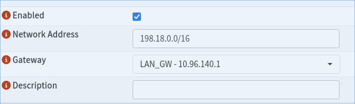

#### Exposition publique d'un LoadBalancer

Pour cela on va créer une règle de DNAT pour renvoyer tout le flux http/https arrivant sur l'ip publique vers le LoadBalancer du cluster :  
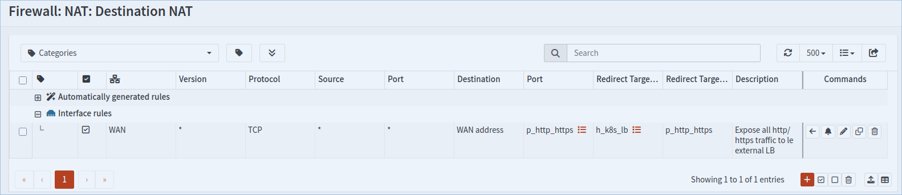
