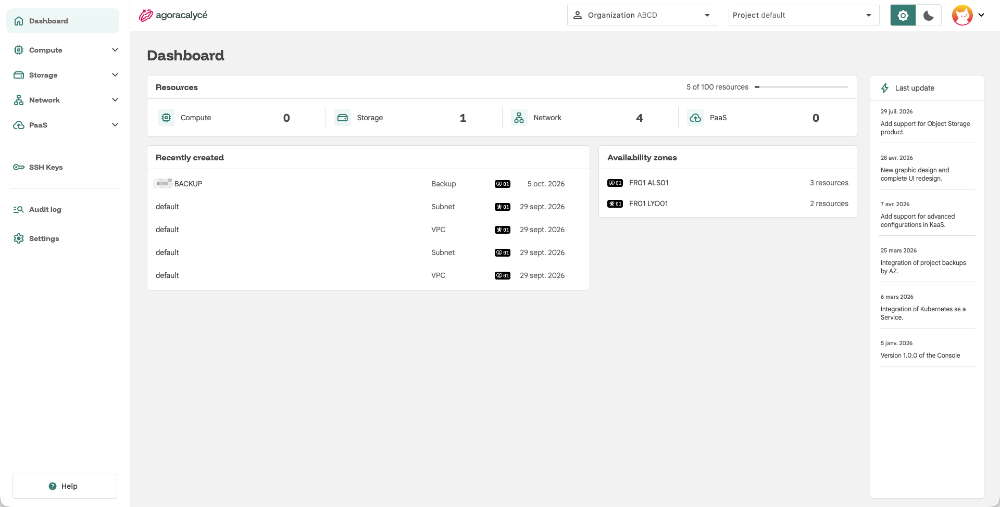

# Documentation de la console d'Agora Calyce

Bienvenue sur la documentation officielle d'utilisation de la **console d'Agora Calyce**, la plateforme Cloud IaaS & PaaS souveraine.  
Ce portail rassemble les guides, bonnes pratiques et procédures pour concevoir, déployer et administrer vos infrastructures.

  <a href="https://console.agoracalyce.com" target="_blank" class="md-button md-button--primary">Accéder à la console</a>
  <a href="02-prise-en-main/03-demarrage-rapide.md" class="md-button">Guide de démarrage rapide</a>

## Par où commencer ?

-   :lucide-rocket: **Prise en main**

    ---

    Se connecter, découvrir le tableau de bord et déployer sa première ressource.

    [:octicons-arrow-right-24: Démarrage rapide](02-prise-en-main/03-demarrage-rapide.md)

-   :lucide-book-open: **Introduction**

    ---

    Comprendre la plateforme et son vocabulaire : organisation, projet, zone de disponibilité, permissions.

    [:octicons-arrow-right-24: Concepts](01-introduction/02-concepts.md)

-   :lucide-users: **Administration**

    ---

    Gérer son compte, ses organisations, ses projets, les droits des utilisateurs et l'audit log.

    [:octicons-arrow-right-24: Administration](03-administration/01-son-compte.md)

-   :lucide-server: **Utilisation**

    ---

    Créer et gérer instances, stockage, réseau et sauvegardes depuis la console.

    [:octicons-arrow-right-24: Créer une instance](04-utilisation/01-instance/01-creation-from-scratch.md)

-   :lucide-container: **PaaS**

    ---

    Déployer et exposer un cluster Kubernetes managé (KaaS), le mettre à jour.

    [:octicons-arrow-right-24: Kubernetes](05-paas/01-kaas/01-creer-cluster.md)

-   :lucide-database: **Object Storage**

    ---

    Créer des buckets compatibles S3 et récupérer les accès.

    [:octicons-arrow-right-24: Créer un bucket](06-object-storage/01-creation-bucket.md)

